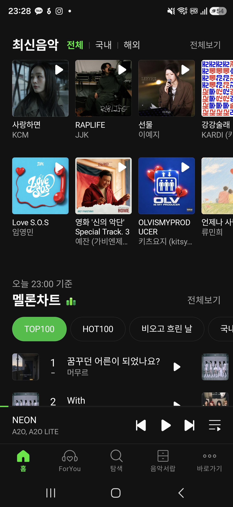
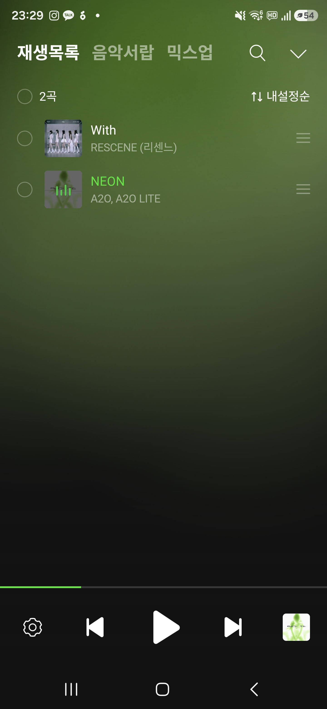
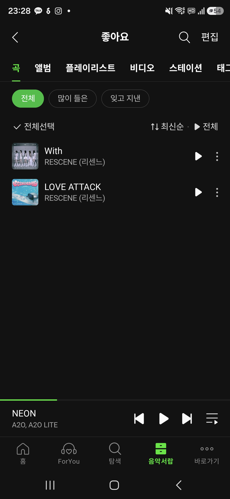
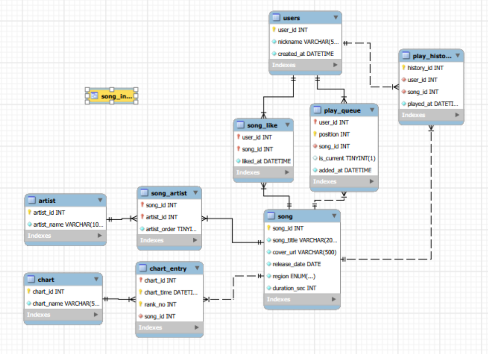

# AI용 전체자료: 멜론 DB 텀프로젝트

> **이 파일 하나에 프로젝트 자료 전부(문서 + SQL + API 코드)가 들어 있어요.** (버전 v4.0) ZIP을 열 수 없는 AI에도 이 파일만 올리면 돼요.
> 이 파일은 ZIP을 만들 때 자동으로 합쳐서 만들어요. **직접 고치지 말고**, 고칠 내용은 원본 파일(`docs/`, `sql/`)에서 고쳐 주세요.

---

## 팀원용: AI에게 이렇게 물어보세요

1. 이 파일(`AI용_전체자료.md`)을 AI 채팅(Claude, ChatGPT, Gemini 등)에 첨부해요.
   - 화면을 보여주고 싶으면 `images/` 폴더의 스크린샷(`view1_home.jpg`, `view2_play_queue.jpg`, `view3_like_songs.jpg`)과 `erd.png`도 같이 첨부해요.
   - 과제 원문이 필요하면 `참고자료/TP_DB_과제공지.pdf`도 첨부해요.
2. 아래 문장을 복사해서 `[ ]` 부분만 바꿔 보내요.

```
첨부한 "AI용_전체자료.md"는 우리 팀 데이터베이스 텀프로젝트 자료야.
맨 위 "AI에게 주는 안내"를 먼저 읽고 그대로 따라줘.
나는 역할 [A / B / C / D] 이고, 진행계획(00_진행계획.md)에서 내가 할 다음 일은 [ ]이야.
이걸 같이 하자. 모르는 부분은 나한테 먼저 물어봐줘.
```

---

## AI에게 주는 안내 (AI는 이 부분을 먼저 읽고 따라 주세요)

당신은 대학교 "데이터베이스" 과목의 4인 팀 프로젝트를 돕는 조수예요. 사용자는 이 팀의 팀원 한 명이에요.

### 프로젝트 한 줄 요약
멜론(Melon) 음악 앱의 화면 3개(**홈**, **재생목록**, **음악서랍 > 좋아요 > 곡**)를 그리는 데 필요한 **MySQL 데이터베이스를 설계**하고, 각 화면용 **API를 Python Flask로 개발**한 뒤, **보고서와 10분 발표**로 제출해요. 제출 마감은 11/29(일) 23:59예요.

### 현재 상태
- **완료**: 진행 계획, 화면 분석, 테이블 설계(9개 + VIEW 1개, 3NF), ERD, 샘플 데이터(사용자 3, 곡 15, 차트 10위), 화면별 SELECT 쿼리 8개, **Flask API 11개(`api/app.py`, 실행 확인함)**, Postman 컬렉션, **보고서·발표 슬라이드 초안**(`report/`)
- **남은 것**: `00_진행계획.md` 2절 체크리스트의 빈칸이에요. 예: 역할·발표자 이름 채우기, PPT 14번을 실제 Postman 캡처로 교체, MySQL 8에서 최종 확인, 리허설, 제출
- 보고서(.docx)와 PPT(.pptx)는 이 파일에 들어 있지 않아요. 필요하면 `report/` 폴더의 파일을 따로 첨부해 달라고 하세요.
- 역할 A(DB), B(API 홈), C(API 재생목록과 좋아요), D(문서와 발표)는 `00_진행계획.md` 1절에 있어요. 각 역할의 할 일 체크리스트는 2절에 있어요.

### 이미 정해진 것 (팀 합의 없이 바꾸지 마세요)
`03_결정사항.md`의 "결정된 것" 표가 기준이에요. 특히 다음은 꼭 지켜 주세요.
- DB는 **MySQL 8.x**, API는 **Python Flask + pymysql**, 테스트는 **Postman**
- 테이블은 `users`, `artist`, `song`, `song_artist`, `chart`, `chart_entry`, `play_queue`, `song_like`, `play_history` **9개**, VIEW는 `song_info` **1개**
  - **앨범 테이블은 일부러 뺐어요.** 커버, 발매일, 국내/해외는 `song`에 있어요.
- API는 `04_API명세.md`의 **11개**예요(조회 5 + 쓰기 6). 11번 `POST /api/users/<id>/plays`가 재생 기록을 쌓아요. 에러는 `{"error": "이유"}` + 400/404/409로 돌려줘요.
- "많이 들은" = **3회 이상** 들은 좋아요 곡, "잊고 지낸" = 30일 넘게 안 들었거나 한 번도 안 들은 좋아요 곡이에요.
- 화면별 쿼리는 `sql/03_view_queries.sql`에 있어요. `api/app.py`에도 같은 쿼리가 `%s` 입력값 방식으로 들어 있어서, 쿼리를 바꾸면 **두 곳을 같이** 고쳐야 해요. 입력값은 `@변수`(`@user_id`, `@region`, `@chart_id`, `@now`)로 받고, 곡 정보와 아티스트 이름은 VIEW `song_info`를 JOIN해서 가져와요.
- `play_queue.is_current`는 **재생 중 = 1, 아니면 NULL**이에요(0 아님). `UNIQUE(user_id, is_current)` + `CHECK(is_current = 1)`로 "사용자당 재생 중인 곡 1곡"을 DB가 보장해요.
- `ON DELETE CASCADE`는 `song_artist`에만 있어요. 재생 기록·좋아요·재생목록·차트는 데이터 보호를 위해 일부러 넣지 않았어요.
- ERD(`images/erd.png`)는 MySQL Workbench로 실제 DB에서 생성했어요. DB 변경 이유는 `docs/06_DB변경사항.md`에 있어요.
- 멜론차트는 **1시간 단위**로 저장해요. 순위 변동(▲▼NEW)은 저장하지 않고, 직전 시각 기록과 셀프 조인해서 계산해요.
- "재생목록"은 지금 듣는 곡 대기열이에요. 사용자가 이름을 붙여 만드는 "플레이리스트"가 아니에요. 좋아요는 **곡 탭만** 다뤄요.
- 로그인은 구현하지 않고, URL의 `user_id`로 사용자를 구분해요.
- 이름 규칙: 테이블과 컬럼은 소문자 snake_case, API URL은 소문자 kebab-case. API 목록은 `04_API명세.md`를 따라요.

### 이렇게 도와주세요
1. **한국어로**, 수업에서 배운 수준(SELECT, JOIN, GROUP BY, 서브쿼리, VIEW, 정규화 1NF~3NF)에 맞춰 쉽게 설명해 주세요. 새 문법을 쓸 때는 무엇인지 한 줄 설명을 붙여 주세요.
2. 위의 "정해진 것"을 바꿔야 할 것 같으면, 바로 바꾸지 말고 **"팀에 제안할 내용"**으로 이유와 함께 따로 정리해 주세요. 팀 합의 뒤 관리자가 `03_결정사항.md`에 기록해요.
3. 파일을 고치면 **고친 파일 전체 내용**을 보여 주고, 마지막에 "어떤 파일의 어디를 왜 고쳤는지" 한 줄 요약을 써 주세요. 팀원은 이 요약과 파일을 카톡으로 관리자에게 보내요(`00_진행계획.md` 6절 파일 공유 규칙). ZIP 이름은 `melon_code_v번호.0.zip`이에요.
4. 스키마나 쿼리가 바뀌면 `01_schema.sql`, `02_sample_data.sql`, `03_view_queries.sql`, `api/app.py`, `02_DB설계.md`, `05_실행가이드.md`의 기대 결과가 서로 맞는지 같이 확인해 주세요. 보고서와 PPT에도 반영할 곳이 있는지 알려 주세요.
5. DB 비밀번호가 들어 있는 `api/config.py`는 절대 공유하지 않아요. 예시는 `config.example.py`예요.
6. 모르는 것(팀이 아직 안 정한 것, 수업 범위 등)은 추측하지 말고 사용자에게 물어봐 주세요. 아직 안 정해진 것은 `03_결정사항.md`의 "결정할 것" 표에 있어요.
7. 샘플 데이터의 발매일, 재생시간, 커버 URL, 재생 기록, 22:00 차트, 차트 3~10위, 12번 곡 제목("언제나 사랑해", 스크린샷에서 잘린 것을 추정)은 **테스트용 임의 값**이에요. 실제 멜론 데이터처럼 설명하지 마세요.

### 스크린샷 내용 (이미지를 볼 수 없는 AI용 설명)
- **홈** (`images/view1_home.jpg`)
  - 상단 "최신음악" 영역: 전체/국내/해외 탭이 있고, 가로로 넘기는 카드(커버 + 곡명 + 아티스트)가 있어요. 사랑하면/KCM, RAPLIFE/JJK, 선물/이예지, 강강술래/KARDI, Love S.O.S/임영민 등이 보여요.
  - 그 아래 "멜론차트": "오늘 23:00 기준", TOP100/HOT100/비오고 흐린 날 등의 탭이 있어요. 1위 꿈꾸던 어른이 되었나요?/머무르(순위 아래 `-`), 2위 With/RESCENE이 보여요.
  - 하단 미니플레이어에 NEON/A20, A20 LITE가 나와요.
- **재생목록** (`images/view2_play_queue.jpg`)
  - "2곡", 정렬 "내설정순"이 보여요.
  - 1. With/RESCENE (리센느), 2. NEON/A20, A20 LITE예요. 지금 재생 중인 NEON은 초록색이에요.
  - 하단에 재생 진행바와 재생 버튼이 있어요.
- **좋아요 > 곡** (`images/view3_like_songs.jpg`)
  - 탭은 곡/앨범/플레이리스트/비디오/스테이션/태그예요.
  - 필터는 전체/많이 들은/잊고 지낸이고, 정렬은 "최신순"이에요.
  - 목록은 With/RESCENE (리센느), LOVE ATTACK/RESCENE (리센느)예요.
- **ERD** (`images/erd.png`): 9개 테이블과 관계를 그린 그림이에요. 내용은 아래 `02_DB설계.md`와 `01_schema.sql`과 같아요.

### 파일 구성 (원본 ZIP 기준)
| 경로 | 내용 |
|---|---|
| `README.md` | 프로젝트 개요, 읽는 순서 |
| `docs/00_진행계획.md` | 진행 순서, 역할, 단계별 할 일, 발표와 보고서 구성안, 작업 규칙, 파일 공유 규칙 |
| `docs/01_화면분석.md` | 화면별 필요 데이터 |
| `docs/02_DB설계.md` | ERD, 테이블, VIEW, 정규화 근거, 발표 Q&A 대비 |
| `docs/03_결정사항.md` | 결정할 것과 결정된 것 |
| `docs/04_API명세.md` | API 목록 |
| `docs/05_실행가이드.md` | SQL 실행 방법과 기대 결과 |
| `docs/06_DB변경사항.md` | DB 최종 변경 내용과 이유 |
| `변경내역.md` | ZIP 버전 기록 |
| `sql/01_schema.sql` → `02_sample_data.sql` → `03_view_queries.sql` | 이 순서로 실행 |
| `api/` | Flask API 11개: `app.py`, `db.py`, `config.example.py`, `requirements.txt`, `README.md`(실행 방법), `postman_collection.json` |
| `report/보고서.docx`, `report/발표슬라이드.pptx` | 보고서와 발표 슬라이드 초안 (이 파일에는 미포함) |
| `images/` | 앱 스크린샷 3장, ERD |
| `참고자료/TP_DB_과제공지.pdf` | 교수님 과제 공지 원문 |

아래부터는 위 파일들의 **원문을 그대로** 이어 붙였어요(Postman 컬렉션, 보고서, PPT, 이미지는 제외). 문서 안의 이미지와 링크는 이 파일에서는 열리지 않아요. 이미지는 `images/` 폴더를 보면 돼요.


---

# 📄 파일: `README.md`

## 데이터베이스 텀프로젝트: 멜론 앱 DB 설계 & API

멜론 음악 앱의 화면 3개를 골라, 그 화면을 그리는 데 필요한 **데이터베이스를 설계**하고 **API를 개발**하는 4인 팀 프로젝트예요.

> **팀원 읽는 순서**
> 0. 문서 여는 법: VSCode로 이 폴더를 열고 .md 파일에서 `Ctrl + Shift + V`(미리보기). 메모장으로 열면 표가 깨져 보여요.
> 1. 이 README (5분)
> 2. [`docs/00_진행계획.md`](docs/00_진행계획.md): 진행 순서, 역할, 할 일, 카톡+ZIP 파일 공유 규칙(6절) (10분)
> 3. [`docs/03_결정사항.md`](docs/03_결정사항.md): **열린 결정사항에 의견 남기기**
> 4. [`docs/05_실행가이드.md`](docs/05_실행가이드.md): 내 PC에서 SQL과 API 실행해 보기
>
> 지금 버전: **v4.0**. 무엇이 바뀌었는지(파일별 상세 포함)는 [`변경내역.md`](변경내역.md)에 있어요.
> **v4.0 핵심**: DB 최종본. "재생 중인 곡은 사용자당 1곡"을 DB 제약(UNIQUE + CHECK)으로 보장, CASCADE는 song_artist에만, ERD를 Workbench로 다시 생성. MySQL 8에서 실행 확인 완료.

### AI(Claude, ChatGPT, Gemini 등)와 같이 작업할 때

[`AI용_전체자료.md`](AI용_전체자료.md) **파일 하나만 AI에 첨부**하면 돼요. 문서, SQL, API 코드가 전부 들어 있고, AI가 지켜야 할 규칙(정해진 것, 바꾸면 안 되는 것)도 맨 위에 적혀 있어요.
- 맨 위 "팀원용: AI에게 이렇게 물어보세요"의 문장을 복사해서 쓰면 돼요.
- 화면을 보여주고 싶으면 `images/`의 스크린샷도 같이 첨부해요. 과제 원문은 `참고자료/TP_DB_과제공지.pdf`에 있어요.
- AI가 고쳐 준 파일은 "어떤 파일의 어디를 왜 고쳤는지" 한 줄과 함께 관리자에게 보내 주세요.

### 과제 요구사항 (TP_DB.pdf 요약)

- 모바일 앱 1개 + 화면 3개 이상 선택
- 화면을 만들기 위한 **DB 구축** + 각 화면의 **API 개발**
- **발표 (10분 + Q&A 5분)**: 앱/화면 소개 → DB 설계 → API
- **보고서**: 앱/화면 소개, DB 설계(테이블, 쿼리, 데이터셋, ERD), API(입력값, JSON 출력)
- 사용 도구 (Week9_2): **Python, VSCode, Postman, MySQL**

### 진행 순서

진행 순서만 정해 두고, 단계별 날짜는 킥오프에서 팀이 정해요. 자세한 내용은 [`docs/00_진행계획.md`](docs/00_진행계획.md)에 있어요.

| 순서 | 단계 | 내용 |
|---|---|---|
| 0 | 기초 작업 ✅ | 계획, 화면 분석, 기초 테이블, 샘플 데이터, 쿼리 |
| 1 | 킥오프 | 역할 배정, 결정사항 확정, **단계별 날짜 정하기**, 각자 SQL 실행 확인 |
| 2 | DB 확정 + API 개발 ✅ | 스키마 확정, ERD, Flask API (**DB 최종 완료, API 11개 구현 완료**) |
| 3 | 테스트 + 명세 | Postman 테스트, API 명세 완성 |
| 4 | 보고서 + 슬라이드 🔶 | 원고 취합, 최종 점검, 리허설 (**초안 완성**) |
| 5 | 제출 + 발표 | 슬라이드, 보고서 제출 → 10분 발표 + Q&A 5분 → 동료 평가 |

> 과제 공식 마감(교수님 공지): 슬라이드와 보고서 제출 **11/29(일) 23:59**, 발표 12/1(화) 또는 12/7(월)

### 선택한 화면

| # | 화면 | 범위 |
|---|---|---|
| 1 | 홈 | 최신음악(전체/국내/해외), 멜론차트(순위 변동 포함), 미니플레이어 |
| 2 | 재생목록 | 곡 수, 곡 리스트(내설정순), 현재 재생 곡 |
| 3 | 음악서랍 > 좋아요 > 곡 | 전체(최신순) / 많이 들은 / 잊고 지낸 |

<p>
  
  
  
</p>

### 기초 테이블 (9개) + VIEW 1개

- 테이블: `users`, `artist`, `song`, `song_artist`, `chart`, `chart_entry`, `play_queue`, `song_like`, `play_history`
- VIEW: `song_info` (곡 정보 + 아티스트 이름을 한 줄로 합친 것)
- 설명은 [`docs/02_DB설계.md`](docs/02_DB설계.md)



### 문서와 파일

| 파일 | 내용 | 상태 |
|---|---|---|
| [`docs/00_진행계획.md`](docs/00_진행계획.md) | 진행 순서, 역할(A~D), 단계별 할 일, 발표와 보고서 구성안, 파일 공유 규칙 | ✅ |
| [`docs/01_화면분석.md`](docs/01_화면분석.md) | 화면별 필요 데이터 | ✅ |
| [`docs/02_DB설계.md`](docs/02_DB설계.md) | ERD, 테이블, 정규화 근거, Q&A 대비 | ✅ |
| [`docs/06_DB변경사항.md`](docs/06_DB변경사항.md) | DB 최종 변경 내용과 이유 (재생 중 1곡 제약, CASCADE, HOT100, LEFT JOIN, ERD) | ✅ |
| [`docs/03_결정사항.md`](docs/03_결정사항.md) | 결정할 것과 결정된 것 | 🔶 일부 의견 필요 |
| [`docs/04_API명세.md`](docs/04_API명세.md) | API 목록 11개, 시연 흐름 (JSON 예시는 보고서 4.2절) | ✅ |
| [`docs/05_실행가이드.md`](docs/05_실행가이드.md) | SQL·API 실행 방법과 기대 결과, md 여는 법 | ✅ |
| [`images/erd.png`](images/erd.png) | ERD 이미지 (MySQL Workbench로 생성) | ✅ |
| [`변경내역.md`](변경내역.md) | ZIP 버전별 변경 기록 | ✅ |
| [`AI용_전체자료.md`](AI용_전체자료.md) | AI에 첨부할 통합 파일 (문서 + SQL + API 코드, ZIP 만들 때 자동 생성) | ✅ |
| `images/` | 앱 스크린샷 3장 (`view1_home.jpg`, `view2_play_queue.jpg`, `view3_like_songs.jpg`) | ✅ |
| [`참고자료/TP_DB_과제공지.pdf`](참고자료/TP_DB_과제공지.pdf) | 교수님 과제 공지 원문 | ✅ |
| [`sql/01_schema.sql`](sql/01_schema.sql) | CREATE TABLE 9개 + CREATE VIEW 1개 | ✅ 실행 확인 |
| [`sql/02_sample_data.sql`](sql/02_sample_data.sql) | 샘플 데이터 (사용자 3, 곡 15, 차트 10위까지) | ✅ 실행 확인 |
| [`sql/03_view_queries.sql`](sql/03_view_queries.sql) | 화면별 SELECT 8개 | ✅ 실행 확인 |
| [`api/`](api/README.md) | Flask API 11개 (`app.py`, `db.py`, `config.example.py`, `requirements.txt`, `postman_collection.json`, 실행 방법 `README.md`) | ✅ 실행 확인 |
| `report/보고서.docx` | 보고서 초안 (이름·역할 칸 비어 있음) | 🔶 초안 |
| `report/발표슬라이드.pptx` | 발표 슬라이드 초안 16장 (발표자 칸 비어 있음, 14번 Postman 캡처 교체 필요) | 🔶 초안 |


---

# 📄 파일: `docs/00_진행계획.md`

## 00. 진행 계획

> **처음 보는 팀원은 이 문서부터 읽어 주세요.**
> 최종 목표: 슬라이드와 보고서를 사이버캠퍼스에 제출하고 10분 발표하기
> 이 문서는 **순서**만 정해 둬요. 단계별 날짜는 킥오프(1단계)에서 팀이 함께 정해서 0절 표에 적어 주세요.
> (과제 공식 마감: 제출 11/29(일) 23:59, 발표 12/1 또는 12/7)

---

### 0. 한눈에 보기

| 순서 | 단계 | 하는 일 | 날짜 (킥오프에서 정하기) |
|---|---|---|---|
| 0 | 기초 작업 ✅ | 계획, 화면 분석, 기초 테이블, 샘플 데이터, 화면별 쿼리 | 완료 |
| 1 | 킥오프 | 역할 배정, 결정사항 확정, 날짜 정하기, 각자 PC에서 SQL 실행 확인 | |
| 2 | DB 확정 + API 개발 | A는 DB 확정과 ERD, B와 C는 API 개발 (동시에 진행) | |
| 3 | 테스트 + 명세 | Postman 테스트, API 명세 완성, 버그 수정 | |
| 4 | 보고서 + 슬라이드 | 원고 넘기기 → 합치기 → 최종 점검과 리허설 (전원) | |
| 5 | 제출 + 발표 | 제출(마감 직전은 피하기), 10분 발표 + Q&A 5분 | 제출 11/29 23:59 (공식) |

> **현재 상태 (v4.0)**: **DB 최종 완료**(MySQL 8 실행 확인, Workbench ERD). API 11개 구현, 보고서와 발표 슬라이드 초안 완성. 남은 것은 아래 체크리스트의 빈칸이에요.

각 단계는 **앞 단계가 끝나야 시작**하는 게 원칙이에요. 단, 2단계에서 D(문서)는 1장(앱/화면 소개)을 먼저 써도 돼요.

### 1. 역할 (4명, 아직 사람 배정 전)

역할을 4개로 나눠 뒀어요. **킥오프에서 이름만 채우면 돼요.** 보고서와 발표에는 모두 자기 파트를 직접 써야 설명하기 쉬워요.

| 역할 | 담당 | 주요 산출물 | 담당자 |
|---|---|---|---|
| **A. DB** | 스키마 확정, ERD, 정규화 설명, 샘플 데이터 확장 | `sql/01~03`, ERD 이미지, `docs/02_DB설계.md` | (기초는 완료) |
| **B. API ① 홈** | Flask 서버 뼈대(공통 DB 연결) + 홈 API | `api/app.py`, `api/db.py`, 홈 API | |
| **C. API ②③ 재생목록, 좋아요** | 재생목록 + 좋아요 API (조회 + 추가/삭제) | 재생목록, 좋아요 API | |
| **D. 문서, 발표** | 보고서, 슬라이드 총괄, Postman 캡처 정리, 발표 대본 | 보고서(.docx 또는 .pdf), 슬라이드 | |

- B가 먼저 서버 뼈대(DB 연결, 실행 방법)를 만들어 올리면 C가 그 위에 이어서 작업해요.
- D는 Phase 2부터 1장(앱/화면 소개)을 먼저 쓰기 시작하면 돼요. 이 부분은 `docs/01_화면분석.md`를 다듬으면 돼요.
- 발표자는 1명이 전부 하거나 파트별로 나눌 수 있어요(결정사항 #9).

### 2. 단계별 상세 계획

#### Phase 1. 킥오프 (전원)
- [ ] 이 문서와 `docs/03_결정사항.md`를 읽고 **열린 결정사항**에 의견 남기기
- [ ] 역할 A~D 배정 (위 표에 이름 채우기)
- [ ] 단계별 날짜 정해서 0절 표에 적기
- [ ] 각자 PC에 MySQL, Workbench, Python, VSCode, Postman 설치 (Week9_2 자료)
- [ ] 각자 `sql/01 → 02 → 03` 실행해서 **같은 결과가 나오는지 확인** → [`05_실행가이드.md`](05_실행가이드.md)
- [ ] 테이블 설계에 이의가 있으면 이번 단계에서 말하기. Phase 2 이후에 바뀌면 API를 다 고쳐야 해요.

#### Phase 2. DB 확정 + API 개발
**A (DB)**
- [x] 스키마 최종: "재생 중인 곡 1곡" DB 제약, song_artist CASCADE (v3.1~v3.2) → [`06_DB변경사항.md`](06_DB변경사항.md)
- [x] MySQL 8에서 `01 → 02 → 03` 실행 확인
- [x] 샘플 데이터 확장: 차트 10위까지, 해외곡 3개, 사용자 3명 (v2.0)
- [x] ERD를 MySQL Workbench(Reverse Engineer)로 다시 그려서 `images/erd.png` 교체
- [x] `docs/02_DB설계.md`의 정규화 예시(재생목록 표 → 1NF → 2NF → 3NF)를 슬라이드용 표로 옮기기 (PPT 9번)

**B (API 홈)**
- [x] `api/` 폴더에 Flask 뼈대 만들기: `app.py`, `db.py`(pymysql 연결), `requirements.txt`, `config.example.py`
- [x] `GET /api/home/new-songs`, `GET /api/home/chart`, `GET /api/users/<id>/now-playing`
- [x] 실행 방법을 `api/README.md`에 적기

**C (API 재생목록, 좋아요)**
- [x] `GET /api/users/<id>/queue`
- [x] `GET /api/users/<id>/likes/songs?filter=all|most|forgotten`
- [x] 쓰기 API: 좋아요 추가/취소, 재생목록에 곡 추가, 삭제, 현재 곡 변경
- [x] 재생 기록 API `POST /api/users/<id>/plays` (11번, v3.0)

**D (문서)**
- [x] 보고서 초안 전체 작성 → `report/보고서.docx`
- [x] 발표 슬라이드 초안 16장 → `report/발표슬라이드.pptx`

#### Phase 3. 테스트 + 명세
- [x] B, C: Postman Collection → `api/postman_collection.json` (11번 요청은 v3.0에서 추가)
- [x] API별 입력값과 JSON 응답 → 보고서 4.2절
- [ ] PPT 14번의 JSON 예시를 **실제 Postman 화면 캡처**로 교체
- [ ] A: 쓰기 API 실행 후 DB가 실제로 바뀌는지 **MySQL 8에서** 확인 (좋아요 → song_like 행 추가, 재생 기록 → play_history 행 추가)
- [ ] 전원: 다른 사람 PC에서도 API가 실행되는지 교차 확인

#### Phase 4. 보고서 + 슬라이드
- [ ] 보고서·PPT에 DB 최종본 반영: 3.2절·PPT 7번 ERD 그림 교체, 4.2절 JSON의 `"is_current": 0` → `null`, 5.2절·PPT 15번 한계 표의 "사용자당 1곡 제약이 DB에 없음" 행 삭제(해결됨) → 설계 포인트(PPT 8번)로 이동
- [ ] 표지, 역할 분담, 발표자 이름 칸 채우기 (보고서 표지·5.3절, PPT 1·2·16번)
- [ ] 각 역할이 자기 파트 원고를 D에게 넘기기
- [ ] D: 보고서와 슬라이드 합치기
- [ ] 전원: 최종 검토 + 발표 리허설 (10분 맞추기)

#### Phase 5. 제출 + 발표
- [ ] 슬라이드와 보고서 제출. 마감 직전 제출은 피하기
- [ ] 발표 전 리허설 1회
- [ ] 발표 (10분 + Q&A 5분), 발표 후 동료 평가

### 3. 발표 구성안 (10분)

| 시간 | 내용 | 자료 |
|---|---|---|
| 1분 | 앱 소개 (멜론), 고른 화면 3개 | 스크린샷 |
| 1.5분 | 화면 분석: "이 화면을 만들려면 어떤 데이터가 필요한가" | `01_화면분석.md` 표 |
| 3분 | DB 설계: ERD, 테이블, **정규화 과정**(재생목록 표 → 1NF → 2NF → 3NF), VIEW로 아티스트 합치기 | ERD, `02_DB설계.md` |
| 3.5분 | API: 화면별 API, Postman 요청과 JSON 응답, 쿼리 1~2개 하이라이트(순위 변동, 잊고 지낸) | Postman 캡처 |
| 1분 | 정리 + 한계/개선점 | |

### 4. 보고서 목차안 (과제 요구사항 기준)

1. **앱과 화면 소개**: 멜론 소개, 화면 3개 스크린샷과 기능 설명
2. **화면 분석**: 화면별 필요 데이터 표
3. **데이터베이스 설계**
   1. 테이블 목록과 컬럼 설명 (PK, FK, 자료형)
   2. ERD
   3. 정규화 과정 (1NF, 2NF, 3NF 예시)
   4. 데이터셋 (샘플 데이터 설명, 일부 표)
   5. 쿼리 (화면별 SELECT와 실행 결과)
4. **API**
   1. API 목록 (Method, URL, 설명)
   2. API별 입력값과 JSON 출력 (Postman 캡처)
5. **결론**: 한계와 개선점, 역할 분담

### 5. 작업 규칙

- **이름 규칙**: 테이블과 컬럼은 소문자 snake_case (`song_like`, `liked_at`). API URL은 소문자 kebab-case (`/new-songs`)
- **SQL 파일은 순서대로 실행**: `01_schema → 02_sample_data → 03_view_queries`. 01을 다시 실행하면 DB가 초기화돼요.
- **스키마 변경은 A와 상의 후에**: 바뀌면 `docs/02_DB설계.md`와 `docs/03_결정사항.md`에 기록
- **비밀번호 공유 금지**: DB 비밀번호는 각자 `config.py`에만 적고, 카톡이나 ZIP에는 `config.example.py`(비밀번호 칸 비운 것)만 보내기
- **결정은 `docs/03_결정사항.md`에 기록**: 카톡에서 정한 것도 여기에 한 줄 남기기
- **진행 체크**: 이 문서의 체크박스를 직접 체크해서 진행 상황 공유

### 6. 파일 공유 규칙 (카톡 + ZIP)

GitHub 없이 카톡으로 파일을 주고받으니, **버전이 꼬이지 않게** 아래 규칙을 지켜요.

1. **관리자 1명**(기초 작업자)이 전체 폴더를 가지고 있고, 팀 카톡에 ZIP을 올려요.
2. ZIP 이름은 `melon_code_v번호.0.zip` (예: `melon_code_v3.0.zip` → 다음은 `v4.0`). **항상 번호가 가장 큰 ZIP 하나만 기준**이에요.
3. 팀원이 파일을 고쳤으면 **고친 파일만** 카톡으로 관리자에게 보내요. 보낼 때 "어떤 파일의 어디를 왜 고쳤는지" 한 줄을 같이 적어 주세요.
   - 예: `sql/02_sample_data.sql - 차트 10위까지 추가함`
4. 관리자는 받은 파일을 합치고 [`../변경내역.md`](../변경내역.md)에 기록한 뒤 새 ZIP을 올려요. ZIP을 만들 때 `AI용_전체자료.md`도 최신 내용으로 다시 만들어요(직접 고치지 않기).
5. **같은 파일을 두 사람이 동시에 고치지 않기**: 역할별로 맡은 파일이 달라요(1절). 남의 파일을 고쳐야 하면 먼저 카톡으로 말하기.
6. 작업을 시작하기 전에 카톡방의 최신 ZIP 버전을 확인하기.

| 역할 | 주로 고치는 파일 |
|---|---|
| A. DB | `sql/*.sql`, `docs/02_DB설계.md`, `images/erd.png` |
| B. API 홈 | `api/app.py`, `api/db.py`, `api/README.md`, `docs/04_API명세.md`의 홈 부분 |
| C. API 재생목록, 좋아요 | `api/` 안의 재생목록, 좋아요, 재생 기록 코드, `docs/04_API명세.md`의 해당 부분 |
| D. 문서 | `report/보고서.docx`, `report/발표슬라이드.pptx` |
| 관리자 | `README.md`, `docs/00_진행계획.md`, `docs/03_결정사항.md`, `변경내역.md` |


---

# 📄 파일: `docs/01_화면분석.md`

## 01. 화면 분석: 화면을 그리려면 어떤 데이터가 필요한가?

교수님 예시(카카오톡 친구 화면)와 같은 방식으로, 각 화면에 보이는 요소를 하나씩 뜯어서 **필요한 데이터**를 뽑았어요.
여기서 뽑은 데이터가 [`02_DB설계.md`](02_DB설계.md)의 테이블이 돼요.

---

### ① 홈


| 영역 | 화면에 보이는 것 | 필요한 데이터 |
|---|---|---|
| 최신음악 | 커버, 곡명, 아티스트명 | 곡명, 아티스트명, 커버 URL |
| 최신음악 | 최신순으로 나열 | **발매일** |
| 최신음악 | 전체 / 국내 / 해외 탭 | **국내/해외 구분** |
| 멜론차트 | "오늘 23:00 기준" | **차트 기준 시각** (차트가 시간마다 갱신됨) |
| 멜론차트 | TOP100 / HOT100 / 비오고 흐린 날 / 국내… | **차트 종류** |
| 멜론차트 | 1, 2, … | **순위** |
| 멜론차트 | 순위 아래 "-" | **순위 변동** (이전 시각 순위와 비교) |
| 멜론차트 | 커버, 곡명, 아티스트명 | 곡 정보 |
| 미니플레이어 | NEON / A20, A20 LITE | **지금 재생 중인 곡** (재생목록 화면과 같은 데이터) |

---

### ② 재생목록


| 영역 | 화면에 보이는 것 | 필요한 데이터 |
|---|---|---|
| 상단 | "2곡" | 재생목록의 곡 수 (COUNT로 계산) |
| 상단 | "내설정순" | **사용자가 정한 순서** (곡마다 순서 번호) |
| 리스트 | 커버, 곡명 | 곡 정보 |
| 리스트 | "A20, A20 LITE" | **한 곡에 아티스트가 여러 명**일 수 있음 |
| 리스트 | NEON만 초록색 | **현재 재생 중인 곡이 무엇인지** |
| 하단 | 진행바 | 재생 위치 → **범위에서 제외** (결정사항) |
| 상단 탭 | 재생목록 / 음악서랍 / 믹스업 | 이번 과제에서는 "재생목록" 탭만 다룸 |

> ℹ️ 이 화면은 멜론의 "재생목록"(지금 듣는 곡 대기열)이에요. 사용자가 이름을 붙여 만드는 "플레이리스트"와는 달라요.
> 팀 결정: **재생목록으로 진행** ([`03_결정사항.md`](03_결정사항.md) #1)

---

### ③ 음악서랍 > 좋아요 > 곡


| 영역 | 화면에 보이는 것 | 필요한 데이터 |
|---|---|---|
| 탭 | 곡 / 앨범 / 플레이리스트 / 비디오 / 스테이션 / 태그 | 이번 과제에서는 **곡** 탭만 (결정사항 #2) |
| 리스트 | 커버, 곡명, 아티스트명 | 좋아요한 곡 정보 |
| 정렬 | "최신순" | **좋아요 누른 시각** |
| 필터 | 전체 | 좋아요한 곡 전부 |
| 필터 | 많이 들은 | **곡별 재생 횟수** |
| 필터 | 잊고 지낸 | **곡별 마지막 재생 시각** |
| 버튼 | ▶ 전체 | 좋아요 곡 전체를 재생목록에 넣기 → 이번 범위에서는 **구현 안 함** (재생목록에 곡 추가 API로 대신 보여줄 수 있음) |

---

### 정리: 뽑아낸 데이터 → 테이블 후보

| 데이터 | 테이블 후보 |
|---|---|
| 사용자 | users |
| 곡명, 커버, 발매일, 국내/해외, 재생시간 | song |
| 아티스트명 | artist |
| 한 곡에 여러 아티스트 | song_artist |
| 차트 종류 | chart |
| 차트 기준 시각, 순위 | chart_entry |
| 재생목록 순서, 현재 재생 곡 | play_queue |
| 좋아요, 좋아요 시각 | song_like |
| 재생 횟수, 마지막 재생 시각 | play_history |


---

# 📄 파일: `docs/02_DB설계.md`

## 02. DB 설계

[`01_화면분석.md`](01_화면분석.md)에서 뽑은 데이터로 만든 기초 테이블이에요. 모든 테이블은 **3NF 이상**을 목표로 해요 (Week9_1 수업 내용).

> 상태: **기초 테이블 완료** (`sql/01_schema.sql`). MySQL 호환 서버에서 MySQL 8 기본 설정(엄격한 GROUP BY 모드)으로 실행해 확인했어요. Phase 1 킥오프 피드백을 받은 뒤 확정해요.
> 실제 SQL: [`../sql/01_schema.sql`](../sql/01_schema.sql), 샘플 데이터: [`../sql/02_sample_data.sql`](../sql/02_sample_data.sql), 화면별 쿼리: [`../sql/03_view_queries.sql`](../sql/03_view_queries.sql)

### ERD


> 이미지 파일: [`../images/erd.png`](../images/erd.png). **MySQL Workbench의 Reverse Engineer**로 실제 `melon` DB에서 자동 생성한 ERD예요. 실선 = 식별 관계(부모 키가 자식 PK의 일부), 점선 = 비식별 관계. 자세한 설명은 [`06_DB변경사항.md`](06_DB변경사항.md) 4절.

### 테이블 상세

| # | 테이블 | PK | FK | 주요 컬럼 | 쓰이는 화면 |
|---|---|---|---|---|---|
| 1 | `users` | user_id | | nickname, created_at | 전체 |
| 2 | `artist` | artist_id | | artist_name ("RESCENE (리센느)" 그대로) | 전체 |
| 3 | `song` | song_id | | song_title, cover_url, release_date, region(국내/해외), duration_sec | 전체 |
| 4 | `song_artist` | (song_id, artist_id) | song, artist | artist_order (표시 순서) | 전체 |
| 5 | `chart` | chart_id | | chart_name (TOP100, HOT100, 비오고 흐린 날) | 홈 (멜론차트) |
| 6 | `chart_entry` | (chart_id, chart_time, rank_no) | chart, song | UNIQUE(chart_id, chart_time, song_id) | 홈 (멜론차트) |
| 7 | `play_queue` | (user_id, position) | users, song | is_current(재생 중 = 1, 아니면 NULL), added_at. **UNIQUE(user_id, is_current) + CHECK(is_current = 1)** | 재생목록, 미니플레이어 |
| 8 | `song_like` | (user_id, song_id) | users, song | liked_at | 좋아요 |
| 9 | `play_history` | history_id | users, song | played_at | 좋아요 (많이 들은 / 잊고 지낸) |

#### VIEW: `song_info`
화면별 쿼리 8개 중 7개가 "곡명 + 아티스트(여러 명이면 쉼표로) + 커버"를 보여줘요(나머지 1개는 곡 수 COUNT). 이 조합을 VIEW 하나로 만들어 두고, 화면별 쿼리는 이 VIEW를 JOIN해서 써요.
- **저장은 정규화해서**: 아티스트는 `song_artist`에 한 줄에 한 명씩 저장(1NF)
- **보여줄 때는 VIEW로 합쳐서**: `A20, A20 LITE`처럼 곡당 한 줄
- VIEW는 데이터를 따로 저장하지 않는 "저장된 SELECT"라서 정규화가 깨지지 않아요

#### 설계하면서 정한 것 (발표 Q&A 대비)
| 질문 | 답 |
|---|---|
| 왜 `user`가 아니라 `users`? | `user`는 MySQL 시스템 테이블(mysql.user)과 헷갈리고, 일부 도구에서 예약어로 취급해서 |
| 왜 `rank`가 아니라 `rank_no`? | `RANK`는 MySQL 8의 예약어(윈도우 함수)라서 |
| 재생목록 PK가 왜 (user_id, song_id)가 아니라 (user_id, position)? | 같은 곡을 재생목록에 두 번 넣을 수 있어서. 순서(내설정순)도 position으로 표현 |
| 좋아요 PK는 왜 (user_id, song_id)? | 같은 곡에 좋아요를 두 번 누를 수 없어서. 중복이 DB 단계에서 막혀요 |
| 재생 기록은 왜 따로 history_id? | 같은 곡을 여러 번 들으니 (user_id, song_id)가 중복돼요. 그래서 행마다 고유 번호를 줘요 |
| 차트에 왜 시각(chart_time)이 PK에 있나? | 차트가 매시 갱신되고, 순위 변동을 계산하려면 이전 시각 기록이 필요해서 |
| 앨범 테이블은 왜 없나? | 고른 화면 3개는 모두 **곡 단위**로 보여줘요(앨범 화면이 없음). 커버, 발매일, 국내/해외를 `song`에 두면 모두 song_id에만 종속돼서 3NF를 만족해요 |
| 재생 기록은 어떻게 쌓이나? | `POST /api/users/<id>/plays` API가 `play_history`에 INSERT 한 줄을 해요. history_id(AUTO_INCREMENT)와 played_at(DEFAULT CURRENT_TIMESTAMP)이 처음부터 있어서 **테이블을 고치지 않고** API만 추가했어요 |
| 재생 중인 곡이 사용자당 1곡인 건 어떻게 보장하나? | `is_current`를 재생 중 = 1, 아니면 NULL로 저장해요. `UNIQUE(user_id, is_current)`는 NULL을 중복으로 치지 않아서 1은 사용자당 한 줄만 가능하고, `CHECK(is_current = 1)`이 다른 값(0 등)을 막아요. **API가 아니라 DB가 규칙을 보장**해요 (MySQL 8.0.16 이상) |
| CASCADE는 왜 `song_artist`에만 있나? | `song_artist`는 곡의 일부라 곡이나 아티스트가 지워지면 같이 지워져야 해요. 재생 기록·좋아요·재생목록·차트 순위는 함부로 지워지면 안 되는 기록이라 일부러 넣지 않았어요(실수로 지우려 해도 FK가 막음). 탈퇴 후 복귀까지 고려하면 soft delete가 개선 방향이에요 |
| 그럼 한계는? | 같은 앨범의 곡이 여러 개면 커버와 발매일이 곡마다 반복 저장돼요. 앨범 화면을 추가한다면 `album` 테이블을 분리하는 게 개선 방향이에요 |

### 정규화 근거 (발표, 보고서용)

수업 자료(Week9_1)의 1NF → 2NF → 3NF 흐름 그대로, **재생목록 화면을 한 테이블에 다 넣은 것**에서 출발해 나눠요.

#### 출발점: 재생목록 화면을 그대로 표로 만들면
PK = (user_id, position)

| <u>user_id</u> | <u>position</u> | nickname | song_id | song_title | cover_url | artists |
|---|---|---|---|---|---|---|
| 1 | 1 | 멜론유저 | 1 | With | …/1.jpg | RESCENE (리센느) |
| 1 | 2 | 멜론유저 | 3 | NEON | …/3.jpg | **A20, A20 LITE** |

#### 1NF: 반복 그룹 제거
- `A20, A20 LITE`처럼 한 칸에 값이 여러 개 → **반복 그룹**
- → 아티스트를 `artist(artist_id, artist_name)`로 빼고, 곡과의 연결은 `song_artist(song_id, artist_id)`로 한 행에 하나씩 저장

#### 2NF: 부분 종속 제거
- (user_id, position) → song_id ✅
- **user_id → nickname** ❌ **부분 종속** (PK의 일부인 user_id에만 종속)
- → nickname은 `users(user_id, nickname)`로 분리

#### 3NF: 이행 종속 제거
- **(user_id, position) → song_id → song_title, cover_url** ❌ **이행 종속** (키가 아닌 song_id를 거쳐서 결정됨)
- → 곡 정보는 `song(song_id, song_title, cover_url, …)`로 분리

#### 결과
| 테이블 | 남는 컬럼 |
|---|---|
| `play_queue` | <u>user_id</u>, <u>position</u>, song_id, is_current, added_at |
| `users` | <u>user_id</u>, nickname |
| `song` | <u>song_id</u>, song_title, cover_url, release_date, region, duration_sec |
| `song_artist` | <u>song_id</u>, <u>artist_id</u>, artist_order |
| `artist` | <u>artist_id</u>, artist_name |

나머지 테이블(`song_like`, `play_history`, `chart`, `chart_entry`)도 같은 방식으로 곡과 사용자 정보는 ID로만 참조해요. 그래서 모두 3NF예요.

#### 일부러 저장하지 않는 값 (계산으로 구함)
| 화면 값 | 구하는 방법 (`03_view_queries.sql`) |
|---|---|
| 재생목록 "2곡" | `COUNT(*)` from play_queue |
| 아티스트 "A20, A20 LITE" | **VIEW `song_info`** 안에서 `GROUP_CONCAT(artist_name ORDER BY artist_order)`로 합침. 화면별 쿼리는 모두 이 VIEW를 JOIN |
| 차트 순위 변동 | 같은 차트의 **직전 chart_time**과 LEFT JOIN → `이전 순위 - 현재 순위` (없으면 NEW) |
| 많이 들은 | play_history `COUNT(*)`가 **3회 이상**인 좋아요 곡, 많이 들은 순 (`HAVING`) |
| 잊고 지낸 | play_history `MAX(played_at)`이 30일 이전이거나 재생 기록이 없는 좋아요 곡 |

순위 변동이나 재생 횟수를 컬럼으로 저장하면, 원본이 바뀔 때마다 같이 고쳐야 해요(**갱신 이상**). 그래서 계산 방식을 택했어요.


---

# 📄 파일: `docs/03_결정사항.md`

## 03. 결정사항

팀이 정해야 할 것과 이미 정한 것을 기록해요. 카톡에서 정한 것도 여기에 한 줄씩 남겨 주세요.
**결정되면 "결정된 것" 표로 옮기고 날짜를 적어 주세요.**

### 결정할 것 (킥오프에서 정하기)

| # | 질문 | 선택지 | 제안 | 팀 의견 |
|---|---|---|---|---|
| 5 | 역할 A~D 배정 | [`00_진행계획.md`](00_진행계획.md) 1절 | 기초를 만든 사람이 A(DB) | |
| 7 | "잊고 지낸" 기준 | 30일 / 60일 / 90일 이상 안 들음 | 30일 (지금 쿼리 기준). 바꾸면 `03_view_queries.sql` 한 줄만 수정 | |
| 9 | 발표자 | 1명이 전부 / 파트별 나눠서 | 파트별 (Q&A 대응이 쉬움) | |
| 12 | 단계별 날짜 | [`00_진행계획.md`](00_진행계획.md) 0절 표 | 제출일(11/29) 전에 "원고 넘기기", "최종 점검" 날짜를 따로 잡기 | |

### 결정된 것

| 날짜 | # | 내용 |
|---|---|---|
| 11/15 | | 앱: **멜론** |
| 11/15 | 1 | 플레이리스트 화면 = **재생목록(지금 듣는 곡 대기열)**. 사용자가 만드는 "내 플레이리스트"는 하지 않음 |
| 11/15 | 2 | 좋아요 화면 = **곡 탭만** (전체/많이 들은/잊고 지낸 필터 + 최신순) |
| 11/15 | 3 | 홈 화면 = **최신음악(전체/국내/해외) + 멜론차트 + 미니플레이어** |
| 11/15 | 4 | API = **Python Flask** (+ pymysql), 테스트 = **Postman** |
| 11/15 | | DB = **MySQL 8.x** (수업 지정) |
| 11/15 | 8 | **앨범 테이블 제외**. 커버, 발매일, 국내/해외는 `song`에 저장(곡 단위 화면만 있어서 3NF 만족). 테이블 9개 |
| 11/15 | | 재생 진행바(재생 위치)는 범위에서 **제외** (DB보다 앱 상태에 가까움) |
| 11/15 | | 로그인은 구현하지 않고 URL의 `user_id`로 사용자 구분 |
| 11/15 | 11 | 팀 공유는 **카톡 + ZIP**. 관리자(기초 작업자) 1명이 파일을 합쳐 새 버전 ZIP을 올림. 규칙은 [`00_진행계획.md`](00_진행계획.md) 6절 |
| 11/15 | | 결정은 이 파일에 기록 |
| 11/15 | | 팀원 4명, 역할은 미정. 기초 작업(계획, 기초 테이블)은 팀원 1명이 먼저 진행 |
| 11/16 | | `CREATE DATABASE melon;` 으로 단순화 (MySQL 8 기본 문자셋 utf8mb4 사용) |
| 11/16 | | AUTO_INCREMENT 유지 (users, artist, song, chart, play_history) |
| 11/16 | | 쿼리의 입력값은 `@변수`로 유지 (값 바꿀 때 SET 한 줄만 수정) |
| 11/16 | | VIEW `song_info` 추가: 아티스트 이름 합치기를 VIEW 하나로, 화면별 쿼리 단순화 |
| 11/16 | | 멜론차트는 **1시간 단위** + 순위 변동(▲▼NEW) 유지 (스크린샷 "오늘 23:00 기준"과 맞춤) |
| 11/17 | 13 | "많이 들은" = **3회 이상** 들은 좋아요 곡 (`HAVING play_count >= 3`) |
| 11/17 | | 샘플 데이터 확장: 사용자 3명, 곡 15개(해외곡 3), 차트 10위까지 (v2.0) |
| 11/18 | 10 | 쓰기 API 6개: 재생목록 추가·삭제·현재 곡 변경, 좋아요 추가·취소, **재생 기록 추가(11번)** |
| 11/18 | | 재생 기록 API `POST /api/users/<id>/plays` 추가. **테이블 변경 없음** (play_history 그대로 사용) |
| 11/18 | | ZIP 이름 규칙 = `melon_code_v번호.0.zip` (v1 → v2.0 → v3.0 → …) |
| 11/24 | | `play_queue.is_current` = 재생 중 1 / 아니면 NULL + `UNIQUE(user_id, is_current)` + `CHECK(is_current = 1)` → "사용자당 재생 중인 곡 1곡"을 DB가 보장 (v3.1) |
| 11/24 | | `ON DELETE CASCADE`는 `song_artist`에만 (곡의 일부). 재생 기록·좋아요·재생목록·차트는 데이터 보호를 위해 넣지 않음 (v3.2) |
| 11/24 | 6 | ERD 도구 = **MySQL Workbench** (Reverse Engineer로 실제 DB에서 생성) |
| 11/24 | | "많이 들은" 쿼리 `LEFT JOIN`으로 통일 (결과 동일). HOT100 22:00 샘플 1행 정리 (결과 동일) (v3.2) |


---

# 📄 파일: `docs/04_API명세.md`

## 04. API 명세 (초안)

> 상태: **11개 모두 구현 완료** → [`../api/app.py`](../api/app.py). 실행 방법은 [`../api/README.md`](../api/README.md), Postman 요청 모음은 [`../api/postman_collection.json`](../api/postman_collection.json).
> API별 입력값과 실제 JSON 응답은 **보고서 4.2절**(`report/보고서.docx`)에 있어요.
> 쿼리는 [`../sql/03_view_queries.sql`](../sql/03_view_queries.sql)에 이미 있어요. API는 쿼리의 `@변수` 자리(`@user_id`, `@region`, `@chart_id`)에 입력값을 넣어 실행하고, 결과를 JSON으로 바꿔 주면 돼요.

- 서버: Python **Flask** + **pymysql**
- 주소: `http://localhost:5000`
- 로그인은 구현하지 않고, URL에 `user_id`를 넣어서 사용자를 구분해요(과제 범위 단순화).

### API 목록

| # | 화면 | Method | URL | 설명 | 담당 | 구현 |
|---|---|---|---|---|---|---|
| 1 | 홈 | GET | `/api/home/new-songs?region=&limit=` | 최신음악 (region: 생략=전체, `국내`, `해외`) | B | ✅ |
| 2 | 홈 | GET | `/api/home/chart?chart_id=&limit=` | 멜론차트 최신 기준 시각 + 순위 변동 | B | ✅ |
| 3 | 홈, 재생목록 | GET | `/api/users/<user_id>/now-playing` | 미니플레이어 (현재 재생 곡) | B | ✅ |
| 4 | 재생목록 | GET | `/api/users/<user_id>/queue` | 곡 수 + 곡 리스트 (내설정순) | C | ✅ |
| 5 | 재생목록 | POST | `/api/users/<user_id>/queue` | 곡을 재생목록 맨 뒤에 추가 `{"song_id": 4}` | C | ✅ |
| 6 | 재생목록 | PATCH | `/api/users/<user_id>/queue/current` | 현재 재생 곡 바꾸기 `{"position": 1}` | C | ✅ |
| 7 | 재생목록 | DELETE | `/api/users/<user_id>/queue/<position>` | 재생목록에서 곡 빼기 | C | ✅ |
| 8 | 좋아요 | GET | `/api/users/<user_id>/likes/songs?filter=` | filter: `all`(최신순), `most`(많이 들은), `forgotten`(잊고 지낸) | C | ✅ |
| 9 | 좋아요 | POST | `/api/users/<user_id>/likes/songs` | 좋아요 `{"song_id": 3}` | C | ✅ |
| 10 | 좋아요 | DELETE | `/api/users/<user_id>/likes/songs/<song_id>` | 좋아요 취소 | C | ✅ |
| 11 | 재생목록·좋아요 | POST | `/api/users/<user_id>/plays` | 재생 기록 추가 `{"song_id": 2}`. 곡을 한 번 들을 때마다 play_history 1행 → "많이 들은", "잊고 지낸"의 원본 | C | ✅ |

- 조회 5개 + 쓰기 6개. 에러는 `{"error": "이유"}`와 상태 코드(400 잘못된 입력, 404 없음, 409 중복)로 돌려줘요.
- 테스트용으로 `?now=2026-11-15 23:30:00`을 붙이면 차트와 "잊고 지낸"의 기준 시각을 샘플 데이터에 맞춰 고정할 수 있어요.

**발표 시연 추천 흐름 (11번)**: `8. 많이 들은` 조회(With 1곡) → `11. 재생 기록 추가` `{"song_id": 2}` 3번 → `8. 많이 들은` 다시 조회(With, LOVE ATTACK 2곡). 기록이 쌓이면 화면이 바뀌는 걸 보여줄 수 있어요.


---

# 📄 파일: `docs/05_실행가이드.md`

## 05. 실행 가이드 (팀원용)

기초 테이블을 각자 PC에서 실행하고, 결과가 아래와 똑같이 나오는지 확인하는 방법이에요.

### 1. 준비물 (Week9_2 수업 자료 참고)

| 프로그램 | 용도 | 비고 |
|---|---|---|
| MySQL Server 8.x + MySQL Workbench | DB | 설치할 때 정한 root 비밀번호 기억하기 |
| Python 3.11 이상 | API | 설치할 때 "Add python.exe to PATH" 체크 |
| VSCode + Python 확장 | 코드 편집 | |
| Postman | API 테스트 | Phase 3부터 사용 |

### 2. 파일 받기
1. 팀 카톡방에 올라온 **가장 최신 ZIP**(`melon_code_v번호.0.zip`, 예: `melon_code_v3.0.zip`)을 받아서 압축을 풀어요.
2. `term_project_melon/sql/` 폴더에 SQL 파일 3개가 있어요.

#### .md 문서를 보기 좋게 여는 법
- **VSCode**: `term_project_melon` 폴더를 열고 .md 파일을 연 다음 `Ctrl + Shift + V`(미리보기)를 누르면 표와 그림이 정리돼서 보여요.
- 메모장으로 열어도 내용은 읽을 수 있지만 표가 기호(`|`)로 보여요.
- ERD는 이미지 파일 `images/erd.png`로 바로 볼 수 있어요 (MySQL Workbench로 생성).

### 3. SQL 실행 (MySQL Workbench)

1. Workbench에서 로컬 서버(root)에 접속
2. `File > Open SQL Script` → `sql/01_schema.sql` 열기 → ⚡(전체 실행)
   - `melon` DB와 테이블 9개, VIEW 1개(`song_info`)가 생겨요. **다시 실행하면 DB가 초기화돼요.**
3. `sql/02_sample_data.sql` 열기 → ⚡
4. `sql/03_view_queries.sql` 열기 → ⚡ → 아래쪽 Result 탭에서 결과 확인
   - 맨 위 `SET @user_id = 1;` 같은 `@변수` 값을 바꾸면 다른 조건으로 테스트할 수 있어요 (예: `@region = '해외'`, `@chart_id = 2`)

> 터미널을 쓴다면: `mysql -u root -p --default-character-set=utf8mb4 < 01_schema.sql` 같은 식으로 01 → 02 → 03 순서로 실행. **`--default-character-set=utf8mb4`를 빼면 한글이 깨져서 저장될 수 있어요.**

### 4. 이렇게 나오면 성공

**① 홈 - 최신음악 (전체)**: 8곡, 발매일 최신순
```
사랑하면 / KCM → RAPLIFE / JJK → 선물 / 이예지 → 강강술래 / KARDI (카디) → Love S.O.S / 임영민
→ 영화 '신의 악단' Special Track. 3 / 예잔 (가비엔제이) → OLVISMYPRODUCER / 키츠요지 (kitsyoji) → 언제나 사랑해 / 류민희
```
`@region = '해외'`로 바꾸면: Die With A Smile / Lady Gaga, Bruno Mars → Espresso / Sabrina Carpenter → Blinding Lights / The Weeknd

**① 홈 - 멜론차트 (TOP100, 23:00 기준)**
| rank_no | rank_change | 곡 | 의미 |
|---|---|---|---|
| 1 | 0 | 꿈꾸던 어른이 되었나요? / 머무르 | `-` |
| 2 | 0 | With / RESCENE (리센느) | `-` |
| 3 | 1 | NEON / A20, A20 LITE | ▲1 |
| 4 | -1 | RAPLIFE / JJK | ▼1 |
| 5 | 2 | 사랑하면 / KCM | ▲2 |
| 6 | 0 | Die With A Smile / Lady Gaga, Bruno Mars | `-` |
| 7 | -2 | 선물 / 이예지 | ▼2 |
| 8 | 1 | Espresso / Sabrina Carpenter | ▲1 |
| 9 | NULL | 언제나 사랑해 / 류민희 | NEW |
| 10 | -2 | 강강술래 / KARDI (카디) | ▼2 |

**미니플레이어**: NEON / A20, A20 LITE (position 2)

**② 재생목록**: 곡 수 2, 리스트 `1. With (is_current NULL)`, `2. NEON (is_current 1)`  ← 재생 중 = 1, 아니면 NULL

**③ 좋아요 - 전체 (최신순)**: With → LOVE ATTACK
**③ 좋아요 - 많이 들은 (3회 이상)**: With 5회 (LOVE ATTACK은 1회라 안 나와요)
**③ 좋아요 - 잊고 지낸**: LOVE ATTACK (마지막 재생 2025-03-10)

### 5. API 실행 (선택)

`api/README.md`대로 실행하면 돼요. 요약하면 다음과 같아요.
1. `api/config.example.py`를 복사해서 `api/config.py`를 만들고 MySQL 비밀번호를 적어요.
2. `cd api` → `pip install -r requirements.txt` → `python app.py` (주소: `http://localhost:5000`)
3. Postman에서 `api/postman_collection.json`을 Import하면 요청 11개가 화면별 폴더로 들어와요.

### 6. 자주 나는 에러

| 에러 | 원인과 해결 |
|---|---|
| `Unknown database 'melon'` | 01_schema.sql을 먼저 실행 |
| `Duplicate entry ... for key 'PRIMARY'` | 02를 두 번 실행함 → 01부터 다시 실행 |
| 한글이 `???`로 나오거나 INSERT 에러 | MySQL 8은 기본 문자셋이 utf8mb4라 문제없어요. MySQL 5.7 이하라면 `01_schema.sql`의 `CREATE DATABASE melon;`을 `CREATE DATABASE melon DEFAULT CHARACTER SET utf8mb4;`로 바꿔서 실행 |
| `Error Code: 1175` (safe update) | UPDATE/DELETE 테스트 시 `Edit > Preferences > SQL Editor`에서 Safe Updates 체크 해제 |


---

# 📄 파일: `docs/06_DB변경사항.md`

## 변경사항 (DB, v3.0 → 최종)

DB 담당 최종본이에요. **SQL 3개는 v3.2와 같고**, ERD는 MySQL Workbench로 다시 그렸어요. 이 문서는 바뀐 내용과 이유를 실제 코드에 맞게 정리한 거예요.
실행 순서: `sql/01_schema.sql` → `02_sample_data.sql` → `03_view_queries.sql` (MySQL 8.0.16 이상)

---

### 1. `sql/01_schema.sql`

#### 1-1. 재생 중인 곡은 사용자당 1곡: DB가 보장 (v3.1)

**변경 전**
```sql
is_current  TINYINT(1)  NOT NULL DEFAULT 0,   -- 1곡만 1이어야 한다는 규칙은 API가 관리
```

**변경 후**
```sql
is_current  TINYINT(1)  NULL DEFAULT NULL,    -- 재생 중 = 1, 아니면 NULL (0은 쓰지 않음)
...
UNIQUE KEY uq_one_current (user_id, is_current),
CONSTRAINT chk_is_current CHECK (is_current = 1),
```

**이유**
- 보고서 한계에 적었던 "사용자당 재생 중인 곡 1곡 제약이 DB에 없음"을 DB 설계로 해결했어요.
- `UNIQUE (user_id, is_current)`: 같은 사용자에게 `1`은 한 줄만 들어갈 수 있어요. `NULL`은 UNIQUE에서 중복으로 치지 않아서 여러 줄이 가능해요.
- `CHECK (is_current = 1)`: `1`과 `NULL` 말고 다른 값(예: `0`)은 못 들어가요. MySQL 8.0.16 이상에서 검사돼요.
- 확인: 재생 중인 곡을 2개로 만들면 `Duplicate entry` 에러, `0`을 넣으면 CHECK 에러가 나요.

#### 1-2. `song_artist`에만 ON DELETE CASCADE (v3.2)

**변경 전**
```sql
FOREIGN KEY (song_id)   REFERENCES song (song_id),
FOREIGN KEY (artist_id) REFERENCES artist (artist_id)
```

**변경 후**
```sql
FOREIGN KEY (song_id)   REFERENCES song (song_id)     ON DELETE CASCADE,
FOREIGN KEY (artist_id) REFERENCES artist (artist_id) ON DELETE CASCADE
```

**적용 범위**: `song_artist`의 FK 2개에만 적용했어요. `chart_entry`, `play_queue`, `song_like`, `play_history`의 FK에는 **일부러 넣지 않았어요.**

**이유 (데이터 보호)**
- CASCADE는 **곡의 일부인 데이터**에만 걸었어요. `song_artist`(곡의 아티스트 정보)는 곡이나 아티스트가 없으면 의미가 없어서, 함께 지워지게 했어요.
- 반대로 **재생 기록, 좋아요, 재생목록, 차트 순위**는 함부로 지워지면 안 되는 기록이라 CASCADE를 걸지 않았어요. 그래서 사용자나 곡을 실수로 지우려고 해도 FK가 막아 줘요.
- 탈퇴한 사용자가 돌아왔을 때 기록을 그대로 쓰게 하려면, 행을 지우지 않고 `users`에 탈퇴 여부를 표시하는 방식(soft delete)이 개선 방향이에요.

---

### 2. `sql/02_sample_data.sql`

#### 2-1. `is_current` 값 변경 (v3.1)
재생 중이 아닌 곡의 `is_current`를 `0`에서 `NULL`로 바꿨어요(1-1 제약에 맞춤). 재생 중인 곡은 그대로 `1`이에요.

#### 2-2. HOT100 22:00 샘플 1행 삭제 (v3.2)

**변경 전**
```sql
-- HOT100 22:00
(2, '2026-11-15 22:00:00', 1, 5),
(2, '2026-11-15 22:00:00', 2, 4),
(2, '2026-11-15 22:00:00', 3, 7),
```

**변경 후**
```sql
-- HOT100 22:00
(2, '2026-11-15 22:00:00', 1, 5),
(2, '2026-11-15 22:00:00', 2, 4),
```

**이유**: 22:00 HOT100을 23:00과 겹치는 곡만 남겨서, "23:00 3위 선물 = NEW"가 데이터만 봐도 바로 보이게 정리했어요.
※ 삭제 전에도 22:00 3위는 강강술래(7번)라 선물은 이미 NEW로 나왔어요. 그래서 **쿼리 결과는 변경 전과 같아요** (1위 사랑하면 ▲1, 2위 RAPLIFE ▼1, 3위 선물 NEW).

---

### 3. `sql/03_view_queries.sql`

#### 3-1. "많이 들은" 쿼리 `JOIN` → `LEFT JOIN` (v3.2)

**변경 후**
```sql
FROM song_like l
JOIN song_info si ON si.song_id = l.song_id
LEFT JOIN play_history h
       ON h.user_id = l.user_id AND h.song_id = l.song_id
WHERE l.user_id = @user_id
GROUP BY si.song_id, si.song_title, si.artists, si.cover_url
HAVING play_count >= @min_play
```

**이유**: 바로 아래 "잊고 지낸" 쿼리와 같은 LEFT JOIN으로 맞춰서 읽기 쉽게 했어요. `HAVING play_count >= 3` 조건 때문에 0회 곡은 똑같이 빠져서 **결과는 같아요.**
※ `api/app.py`에도 같은 쿼리가 있어요(아직 `JOIN`). 결과는 같지만, 맞추려면 API 담당이 함께 바꿔 주세요.

---

### 4. `images/erd.png`: MySQL Workbench로 다시 그린 ERD

- 이전 ERD(직접 그린 그림)를 **MySQL Workbench의 Reverse Engineer**로 실제 `melon` DB에서 자동 생성한 ERD로 바꿨어요. 그래서 SQL과 100% 같아요.
- 보고서 3.2절과 PPT 7번의 ERD 그림도 이 파일로 바꿔 주세요.
- 선 읽는 법 (Crow's Foot 표기)
  - **실선 = 식별 관계**: 부모의 키가 자식 PK의 일부예요. users–song_like, users–play_queue, song–song_like, song–song_artist, artist–song_artist, chart–chart_entry
  - **점선 = 비식별 관계**: 부모의 키가 자식에서 일반 FK예요. users–play_history, song–play_history, song–play_queue, song–chart_entry
  - `play_queue.is_current`는 빈 마름모(◇)로 보여요. NULL을 허용하는 컬럼이라는 뜻이에요(재생 중 = 1, 아니면 NULL).
- 왼쪽 위 노란 상자 `song_info`는 VIEW예요. FK가 없어서 선이 연결되지 않아요.

### 바뀌지 않은 것
- 테이블 9개, VIEW `song_info`, 각 테이블의 PK와 컬럼 구성
- 나머지 쿼리 7개, 나머지 샘플 데이터


---

# 📄 파일: `변경내역.md`

## 변경내역

ZIP을 새로 올릴 때마다 맨 위에 한 줄씩 추가해요. **카톡방에서 항상 번호가 가장 큰 ZIP을 기준으로 작업해 주세요.**
ZIP 이름 규칙: `melon_code_v번호.0.zip`

| 버전 | 날짜 | 누가 | 바뀐 내용 |
|---|---|---|---|
| `melon_code_v4.0.zip` | 11/24 | 관리자(DB) | **DB 최종본**: 팀원 v3.1·v3.2의 SQL과 `api/app.py`를 합침(재생 중인 곡 1곡 DB 제약, song_artist CASCADE, 많이 들은 LEFT JOIN, HOT100 샘플 정리). **ERD를 MySQL Workbench로 다시 생성**. DB 변경 설명 문서 `docs/06_DB변경사항.md` 추가(실제 코드에 맞게 정리). 02·03·05·00·README 문서 반영. MySQL 8 실행 확인 |
| `melon_code_v3.2.zip` | 11/24 | 팀원 | song_artist FK에 ON DELETE CASCADE, HOT100 22:00 샘플 1행 삭제, 많이 들은 LEFT JOIN |
| `melon_code_v3.1.zip` | 11/24 | 팀원 | `play_queue.is_current` NULL/1 + UNIQUE + CHECK (재생 중인 곡 1곡을 DB가 보장), `api/app.py` 반영 |
| `melon_code_v3.0.zip` | 11/18 | 관리자 | **v2.0(팀원 작업)을 전체 폴더에 합침**: `api/` 추가, `sql/02·03` 교체, `report/`(보고서·PPT) 추가. **재생 기록 API 11번 `POST /api/users/<id>/plays` 추가**(테이블 변경 없음). 보고서·PPT의 API 목록과 개수를 10개에서 11개로 수정. 결정사항 #10·#13·이름 규칙 기록. 실행가이드 기대 결과를 새 샘플 데이터에 맞춤. AI용_전체자료에 API 코드 포함 |
| `melon_code_v2.0.zip` | 11/17 | 팀원 | Flask API 10개 + Postman 컬렉션, 샘플 데이터 확장(사용자 3, 곡 15, 차트 10위), "많이 들은 = 3회 이상", 보고서·발표 슬라이드 초안 |
| v1 | 11/16 | 관리자 | 첫 공유: 진행계획, 화면 분석, DB 설계 + ERD, 결정사항, API 목록, 실행가이드, SQL 3개(테이블 9개 + VIEW 1개), 스크린샷, 과제 공지 PDF, AI용_전체자료 |

### v4.0 상세: 바뀐 파일

| 파일 | 내용 |
|---|---|
| `sql/01_schema.sql` | `play_queue.is_current` NULL/1 + `UNIQUE(user_id, is_current)` + `CHECK(is_current = 1)`, `song_artist` FK 2개에 `ON DELETE CASCADE` |
| `sql/02_sample_data.sql` | `is_current` 0 → NULL, HOT100 22:00 1행 삭제 (쿼리 결과는 같음) |
| `sql/03_view_queries.sql` | "많이 들은" `JOIN` → `LEFT JOIN` (결과 같음) |
| `api/app.py` | 팀원 v3.2 버전: `is_current`를 NULL로 다루도록 수정 (재생목록 추가, 현재 곡 변경, 삭제) |
| `images/erd.png` | MySQL Workbench Reverse Engineer로 다시 생성 |
| `docs/06_DB변경사항.md` | **새 문서**: DB 변경 전/후 코드와 이유 |
| `docs/02_DB설계.md` | play_queue 설명, Q&A 2개 추가(재생 중 1곡 보장, CASCADE 범위), ERD 설명 |
| `docs/03_결정사항.md` | 11/24 결정 4줄 (is_current 제약, CASCADE, ERD 도구, LEFT JOIN·HOT100) |
| `docs/05_실행가이드.md` | 재생목록 기대 결과 `is_current 0` → `NULL` |
| `docs/00_진행계획.md`, `README.md` | v4.0, DB 완료 체크, 보고서·PPT 반영할 일 추가 |

**보고서·PPT는 아직 그대로예요.** 반영할 곳: 3.2절·PPT 7번 ERD 교체, 4.2절 JSON `"is_current": 0` → `null`, 5.2절·PPT 15번 한계 표에서 "사용자당 1곡 제약이 DB에 없음" 삭제.

### v3.0 상세: 바뀐 파일

**새로 추가**
| 파일 | 내용 |
|---|---|
| `api/` (6개) | v2.0 팀원 Flask API 그대로 + `app.py`에 **11번 `POST /api/users/<id>/plays`(재생 기록 추가)**. `postman_collection.json`에 "④ 재생 기록" 폴더 추가. `api/README.md`의 API 개수 10 → 11 |
| `report/보고서.docx` | v2.0 팀원 보고서 + API 11번만 반영: 4.1 목록에 11번 행, 4.2에 "11. 재생 기록 추가" 섹션, 5.1 "API 11개(조회 5 + 쓰기 6)" |
| `report/발표슬라이드.pptx` | v2.0 팀원 PPT + API 11번만 반영: 2·13·15번 슬라이드 "10개" → "11개", 13번 표에 11번 행 추가(행 높이 조정) |

**v2.0 팀원 버전으로 교체**
| 파일 | 내용 |
|---|---|
| `sql/02_sample_data.sql` | 사용자 3명, 곡 15개(해외 3곡), 차트 10위까지 |
| `sql/03_view_queries.sql` | "많이 들은" = 3회 이상 (`HAVING`) |

**수정**
| 파일 | 내용 |
|---|---|
| `README.md` | 현재 버전 v3.0, 진행 상태, 파일 표에 `api/`·`report/` 추가 |
| `docs/00_진행계획.md` | 끝난 일 체크, 남은 일 추가(이름 칸, PPT 14번 Postman 캡처, MySQL 8 확인), ZIP 이름 규칙 |
| `docs/02_DB설계.md` | 많이 들은 = 3회 이상, Q&A "재생 기록은 어떻게 쌓이나?" |
| `docs/03_결정사항.md` | #13, #10, 재생 기록 API, ZIP 이름 규칙 기록 |
| `docs/04_API명세.md` | 11번 추가, 구현 완료 표시, 발표 시연 흐름 |
| `docs/05_실행가이드.md` | 기대 결과를 새 샘플 데이터로 수정, 터미널 한글 깨짐 방지 옵션, API 실행 방법 |
| `AI용_전체자료.md` | 다시 생성 (API 코드 포함, 안내문 최신화) |

**그대로**: `sql/01_schema.sql`(테이블 변경 없음), `images/`, `참고자료/`, `docs/01_화면분석.md`


---

# 📄 파일: `api/README.md`

## api/ : Flask API 실행 방법

### 1. 준비
```bash
cd api
python -m venv .venv
.venv\Scripts\activate          # Windows   (mac: source .venv/bin/activate)
pip install -r requirements.txt
copy config.example.py config.py   # mac: cp config.example.py config.py
```
`config.py` 를 열어 `DB_PASSWORD` 에 자기 PC 의 MySQL root 비밀번호를 적어요.
(`config.py` 는 카톡·ZIP 으로 올리지 않아요.)

### 2. DB 준비
MySQL Workbench 에서 `sql/01_schema.sql` → `sql/02_sample_data.sql` 순서로 실행 (docs/05_실행가이드.md)

### 3. 서버 실행
```bash
python app.py
```
→ `http://localhost:5000` 에서 대기. 브라우저에서 `http://localhost:5000/api/home/chart` 를 열면 JSON 이 보여요.

### 4. Postman 테스트
`postman_collection.json` 을 Postman 에서 **Import** 하면 API 11개가 폴더별로 들어와요.
응답 예시는 `docs/04_API명세.md` 에 있어요.

### 5. 파일 설명
| 파일 | 내용 |
|---|---|
| `app.py` | API 11개 (라우트 + SQL). `sql/03_view_queries.sql` 의 쿼리를 그대로 사용 |
| `db.py` | pymysql 연결, `fetch_all / fetch_one / transaction()` |
| `config.example.py` | DB 접속 설정 틀. 복사해서 `config.py` 로 |
| `requirements.txt` | flask, pymysql |
| `postman_collection.json` | Postman 요청 모음 |

### 6. 테스트용 `now` 파라미터
멜론차트와 "잊고 지낸" 은 "지금 시각" 을 기준으로 계산해요. 샘플 데이터(2026-11-15) 기준으로 결과를 고정해서 보고 싶으면
`?now=2026-11-15 23:30:00` 을 붙이면 돼요. 생략하면 MySQL 의 `NOW()` 를 써요.


---

# 🗄️ 파일: `sql/01_schema.sql`

```sql
-- =====================================================================
-- 멜론 텀프로젝트: 기초 테이블 (MySQL 8.x)
--   화면 ① 홈(최신음악, 멜론차트)  ② 재생목록  ③ 음악서랍 > 좋아요 > 곡
--   설계 근거: docs/02_DB설계.md
--   실행: MySQL Workbench에서 이 파일 전체 실행 → 02_sample_data.sql 실행
--   ※ play_queue 의 CHECK 제약은 MySQL 8.0.16 이상에서만 실제로 검사됨
-- =====================================================================

DROP DATABASE IF EXISTS melon;
CREATE DATABASE melon;
USE melon;

-- ---------------------------------------------------------------------
-- 1. users : 앱 사용자
--    (user 는 MySQL 시스템 테이블 이름과 헷갈려서 users 로 함)
-- ---------------------------------------------------------------------
CREATE TABLE users (
    user_id     INT          NOT NULL AUTO_INCREMENT,
    nickname    VARCHAR(50)  NOT NULL,
    created_at  DATETIME     NOT NULL DEFAULT CURRENT_TIMESTAMP,
    PRIMARY KEY (user_id)
);

-- ---------------------------------------------------------------------
-- 2. artist : 아티스트 (가수, 그룹)
--    화면 표기 "RESCENE (리센느)" 그대로 artist_name 에 저장
-- ---------------------------------------------------------------------
CREATE TABLE artist (
    artist_id    INT           NOT NULL AUTO_INCREMENT,
    artist_name  VARCHAR(100)  NOT NULL,
    PRIMARY KEY (artist_id)
);

-- ---------------------------------------------------------------------
-- 3. song : 곡
--    커버, 발매일, 국내/해외도 곡 단위로 저장 (앨범 화면이 과제 범위 밖이라 album 테이블은 두지 않음)
--    모든 컬럼이 song_id 하나에만 종속 → 3NF
-- ---------------------------------------------------------------------
CREATE TABLE song (
    song_id       INT           NOT NULL AUTO_INCREMENT,
    song_title    VARCHAR(200)  NOT NULL,
    cover_url     VARCHAR(500)  NOT NULL,          -- 커버 이미지
    release_date  DATE          NOT NULL,          -- 홈 > 최신음악 정렬 기준
    region        ENUM('국내', '해외') NOT NULL,   -- 홈 > 최신음악 국내/해외 탭
    duration_sec  INT           NOT NULL,          -- 재생 시간(초)
    PRIMARY KEY (song_id)
);

-- ---------------------------------------------------------------------
-- 4. song_artist : 곡 ↔ 아티스트 (N:M)
--    "NEON — A20, A20 LITE" 처럼 한 곡에 아티스트 여러 명 → 1NF
--    artist_order : 화면에 표시할 순서 (1 = 첫 번째)
-- ---------------------------------------------------------------------
CREATE TABLE song_artist (
    song_id       INT      NOT NULL,
    artist_id     INT      NOT NULL,
    artist_order  TINYINT  NOT NULL DEFAULT 1,
    PRIMARY KEY (song_id, artist_id),
    FOREIGN KEY (song_id)   REFERENCES song (song_id)     ON DELETE CASCADE,
    FOREIGN KEY (artist_id) REFERENCES artist (artist_id) ON DELETE CASCADE
);

-- ---------------------------------------------------------------------
-- 5. chart : 차트 종류 (TOP100, HOT100, 비오고 흐린 날 ...)
-- ---------------------------------------------------------------------
CREATE TABLE chart (
    chart_id    INT          NOT NULL AUTO_INCREMENT,
    chart_name  VARCHAR(50)  NOT NULL,
    PRIMARY KEY (chart_id),
    UNIQUE (chart_name)
);

-- ---------------------------------------------------------------------
-- 6. chart_entry : 시각별 차트 순위 ("오늘 23:00 기준")
--    순위 변동은 저장하지 않고 직전 chart_time 과 비교해서 계산
-- ---------------------------------------------------------------------
CREATE TABLE chart_entry (
    chart_id    INT       NOT NULL,
    chart_time  DATETIME  NOT NULL,                -- 기준 시각 (매 정시)
    rank_no     INT       NOT NULL,                -- rank 는 MySQL 8 예약어라 rank_no
    song_id     INT       NOT NULL,
    PRIMARY KEY (chart_id, chart_time, rank_no),
    UNIQUE (chart_id, chart_time, song_id),        -- 같은 시각 같은 차트에 같은 곡 두 번 X
    FOREIGN KEY (chart_id) REFERENCES chart (chart_id),
    FOREIGN KEY (song_id)  REFERENCES song (song_id)
);

-- ---------------------------------------------------------------------
-- 7. play_queue : 재생목록 (지금 듣는 곡 대기열)
--    position   : "내설정순" 순서 (1, 2, 3 ...)
--    is_current : 지금 재생 중인 곡이면 1, 아니면 NULL  (0 은 쓰지 않음)
--      - CHECK (is_current = 1)        → 넣을 수 있는 값은 1 또는 NULL 뿐
--      - UNIQUE (user_id, is_current)  → 사용자당 1 은 한 행만 가능
--                                        NULL 은 UNIQUE 에서 중복으로 치지 않아서 여러 행 가능
--      → "사용자당 재생 중인 곡은 1곡" 을 API 가 아니라 DB 가 보장
--    같은 곡을 두 번 넣을 수 있어서 PK 는 (user_id, position)
-- ---------------------------------------------------------------------
CREATE TABLE play_queue (
    user_id     INT         NOT NULL,
    position    INT         NOT NULL,
    song_id     INT         NOT NULL,
    is_current  TINYINT(1)  NULL DEFAULT NULL,
    added_at    DATETIME    NOT NULL DEFAULT CURRENT_TIMESTAMP,
    PRIMARY KEY (user_id, position),
    UNIQUE KEY uq_one_current (user_id, is_current),
    CONSTRAINT chk_is_current CHECK (is_current = 1),
    FOREIGN KEY (user_id) REFERENCES users (user_id),
    FOREIGN KEY (song_id) REFERENCES song (song_id)
);

-- ---------------------------------------------------------------------
-- 8. song_like : 곡 좋아요
--    liked_at : "최신순" 정렬 기준
-- ---------------------------------------------------------------------
CREATE TABLE song_like (
    user_id   INT       NOT NULL,
    song_id   INT       NOT NULL,
    liked_at  DATETIME  NOT NULL DEFAULT CURRENT_TIMESTAMP,
    PRIMARY KEY (user_id, song_id),
    FOREIGN KEY (user_id) REFERENCES users (user_id),
    FOREIGN KEY (song_id) REFERENCES song (song_id)
);

-- ---------------------------------------------------------------------
-- 9. play_history : 재생 기록 (한 번 들을 때마다 1행)
--    좋아요 > "많이 들은"(COUNT), "잊고 지낸"(MAX(played_at)) 계산용
-- ---------------------------------------------------------------------
CREATE TABLE play_history (
    history_id  INT       NOT NULL AUTO_INCREMENT,
    user_id     INT       NOT NULL,
    song_id     INT       NOT NULL,
    played_at   DATETIME  NOT NULL DEFAULT CURRENT_TIMESTAMP,
    PRIMARY KEY (history_id),
    FOREIGN KEY (user_id) REFERENCES users (user_id),
    FOREIGN KEY (song_id) REFERENCES song (song_id),
    INDEX idx_history_user_song (user_id, song_id, played_at)
);

-- =====================================================================
-- VIEW. song_info : 곡 정보 + 아티스트 이름을 한 줄로 합친 것
--   저장은 1NF로 나눠서(song_artist), 화면에 보여줄 때만 "A20, A20 LITE" 처럼 합침
--   VIEW 는 데이터를 따로 저장하지 않음 → 테이블들은 그대로 3NF
--   화면별 쿼리(03_view_queries.sql)는 모두 이 VIEW 를 JOIN 해서 사용
-- =====================================================================
CREATE VIEW song_info AS
SELECT s.song_id,
       s.song_title,
       GROUP_CONCAT(ar.artist_name ORDER BY sa.artist_order SEPARATOR ', ') AS artists,
       s.cover_url,
       s.release_date,
       s.region,
       s.duration_sec
FROM song s
JOIN song_artist sa ON sa.song_id   = s.song_id
JOIN artist ar      ON ar.artist_id = sa.artist_id
GROUP BY s.song_id, s.song_title, s.cover_url, s.release_date, s.region, s.duration_sec;
```


---

# 🗄️ 파일: `sql/02_sample_data.sql`

```sql
-- =====================================================================
-- 샘플 데이터 (v2.0 확장판)
--   곡명, 아티스트명, 차트 1~2위, 재생목록, 좋아요 목록은 스크린샷(2026-11-15 23시경)에서 가져옴
--   ※ 발매일, 재생시간, 커버 URL, 재생 기록, 22:00 차트, 3~10위는 테스트용 "임의 값"
--   ※ 해외곡 3곡(Die With A Smile, Espresso, Blinding Lights)은 해외 탭 테스트용
--   ※ 12번 곡 제목은 스크린샷에서 "언제나 사…"까지만 보여서 추정한 값
--   실행 순서: 01_schema.sql → 02_sample_data.sql
-- =====================================================================
USE melon;

-- ---------------------------------------------------------------------
-- users (3명)
-- ---------------------------------------------------------------------
INSERT INTO users (user_id, nickname, created_at) VALUES
(1, '멜론유저',   '2025-03-01 10:00:00'),   -- 스크린샷 주인 (메인 테스트 계정)
(2, '테스트유저', '2025-06-01 10:00:00'),   -- 사용자별로 결과가 갈리는지 확인용
(3, '팝덕후',     '2026-01-15 09:30:00');   -- 해외곡 위주 사용자

-- ---------------------------------------------------------------------
-- artist (16명)
-- ---------------------------------------------------------------------
INSERT INTO artist (artist_id, artist_name) VALUES
(1,  'RESCENE (리센느)'),
(2,  'A20'),
(3,  'A20 LITE'),
(4,  'KCM'),
(5,  'JJK'),
(6,  '이예지'),
(7,  'KARDI (카디)'),
(8,  '임영민'),
(9,  '예잔 (가비엔제이)'),
(10, '키츠요지 (kitsyoji)'),
(11, '머무르'),
(12, '류민희'),
(13, 'Lady Gaga'),
(14, 'Bruno Mars'),
(15, 'Sabrina Carpenter'),
(16, 'The Weeknd');

-- ---------------------------------------------------------------------
-- song (15곡: 국내 12 + 해외 3)
--   최신음악 화면의 왼쪽→오른쪽 순서가 나오도록 발매일을 최신순으로 배치
-- ---------------------------------------------------------------------
INSERT INTO song (song_id, song_title, cover_url, release_date, region, duration_sec) VALUES
(1,  'With',                                  'https://example.com/cover/1.jpg',  '2026-10-20', '국내', 198),
(2,  'LOVE ATTACK',                           'https://example.com/cover/2.jpg',  '2025-03-04', '국내', 185),
(3,  'NEON',                                  'https://example.com/cover/3.jpg',  '2026-09-01', '국내', 203),
(4,  '사랑하면',                              'https://example.com/cover/4.jpg',  '2026-11-14', '국내', 241),
(5,  'RAPLIFE',                               'https://example.com/cover/5.jpg',  '2026-11-13', '국내', 176),
(6,  '선물',                                  'https://example.com/cover/6.jpg',  '2026-11-12', '국내', 222),
(7,  '강강술래',                              'https://example.com/cover/7.jpg',  '2026-11-11', '국내', 169),
(8,  'Love S.O.S',                            'https://example.com/cover/8.jpg',  '2026-11-10', '국내', 210),
(9,  '영화 ''신의 악단'' Special Track. 3',  'https://example.com/cover/9.jpg',  '2026-11-09', '국내', 233),
(10, 'OLVISMYPRODUCER',                       'https://example.com/cover/10.jpg', '2026-11-08', '국내', 158),
(11, '꿈꾸던 어른이 되었나요?',               'https://example.com/cover/11.jpg', '2026-08-15', '국내', 215),
(12, '언제나 사랑해',                         'https://example.com/cover/12.jpg', '2026-11-07', '국내', 204),
(13, 'Die With A Smile',                      'https://example.com/cover/13.jpg', '2026-11-06', '해외', 251),
(14, 'Espresso',                              'https://example.com/cover/14.jpg', '2026-11-05', '해외', 175),
(15, 'Blinding Lights',                       'https://example.com/cover/15.jpg', '2026-11-04', '해외', 200);

-- ---------------------------------------------------------------------
-- song_artist  (아티스트 2명인 곡: NEON, Die With A Smile → 1NF 예시)
-- ---------------------------------------------------------------------
INSERT INTO song_artist (song_id, artist_id, artist_order) VALUES
(1, 1, 1),
(2, 1, 1),
(3, 2, 1), (3, 3, 2),
(4, 4, 1),
(5, 5, 1),
(6, 6, 1),
(7, 7, 1),
(8, 8, 1),
(9, 9, 1),
(10, 10, 1),
(11, 11, 1),
(12, 12, 1),
(13, 13, 1), (13, 14, 2),
(14, 15, 1),
(15, 16, 1);

-- ---------------------------------------------------------------------
-- chart
-- ---------------------------------------------------------------------
INSERT INTO chart (chart_id, chart_name) VALUES
(1, 'TOP100'),
(2, 'HOT100'),
(3, '비오고 흐린 날');

-- ---------------------------------------------------------------------
-- chart_entry
--   23:00 의 TOP100 1, 2위는 스크린샷 그대로, 나머지와 22:00 은 순위 변동 테스트용 임의 값
--   기대 결과(TOP100 23:00, 10위까지):
--     1 꿈꾸던.. '-'   2 With '-'      3 NEON ▲1        4 RAPLIFE ▼1   5 사랑하면 ▲2
--     6 Die With A Smile '-'  7 선물 ▼2  8 Espresso ▲1  9 언제나 사랑해 NEW  10 강강술래 ▼2
--   기대 결과(HOT100 23:00): 1위 사랑하면 ▲1, 2위 RAPLIFE ▼1, 3위 선물 NEW
--   기대 결과(비오고 흐린 날 23:00): 1위 선물 ▲1, 2위 꿈꾸던.. ▼1
-- ---------------------------------------------------------------------
INSERT INTO chart_entry (chart_id, chart_time, rank_no, song_id) VALUES
-- TOP100 22:00
(1, '2026-11-15 22:00:00', 1,  11),
(1, '2026-11-15 22:00:00', 2,  1),
(1, '2026-11-15 22:00:00', 3,  5),
(1, '2026-11-15 22:00:00', 4,  3),
(1, '2026-11-15 22:00:00', 5,  6),
(1, '2026-11-15 22:00:00', 6,  13),
(1, '2026-11-15 22:00:00', 7,  4),
(1, '2026-11-15 22:00:00', 8,  7),
(1, '2026-11-15 22:00:00', 9,  14),
(1, '2026-11-15 22:00:00', 10, 8),
-- TOP100 23:00
(1, '2026-11-15 23:00:00', 1,  11),
(1, '2026-11-15 23:00:00', 2,  1),
(1, '2026-11-15 23:00:00', 3,  3),
(1, '2026-11-15 23:00:00', 4,  5),
(1, '2026-11-15 23:00:00', 5,  4),
(1, '2026-11-15 23:00:00', 6,  13),
(1, '2026-11-15 23:00:00', 7,  6),
(1, '2026-11-15 23:00:00', 8,  14),
(1, '2026-11-15 23:00:00', 9,  12),
(1, '2026-11-15 23:00:00', 10, 7),
-- HOT100 22:00 (23:00 3위인 6번 곡 '선물'이 직전 시각에 없도록 조정 → NEW 테스트)
(2, '2026-11-15 22:00:00', 1, 5),
(2, '2026-11-15 22:00:00', 2, 4),
-- HOT100 23:00
(2, '2026-11-15 23:00:00', 1, 4),
(2, '2026-11-15 23:00:00', 2, 5),
(2, '2026-11-15 23:00:00', 3, 6),
-- 비오고 흐린 날 22:00
(3, '2026-11-15 22:00:00', 1, 11),
(3, '2026-11-15 22:00:00', 2, 6),
-- 비오고 흐린 날 23:00
(3, '2026-11-15 23:00:00', 1, 6),
(3, '2026-11-15 23:00:00', 2, 11);

-- ---------------------------------------------------------------------
-- play_queue  (user 1 스크린샷: With → NEON, NEON 재생 중)
--   is_current : 재생 중 = 1, 아니면 NULL  (0 을 넣으면 CHECK 제약 위반)
-- ---------------------------------------------------------------------
INSERT INTO play_queue (user_id, position, song_id, is_current, added_at) VALUES
(1, 1, 1,  NULL, '2026-11-15 23:10:00'),
(1, 2, 3,  1,    '2026-11-15 23:12:00'),
(2, 1, 4,  1,    '2026-11-15 21:00:00'),
(2, 2, 13, NULL, '2026-11-15 21:01:00'),
(3, 1, 14, 1,    '2026-11-15 20:00:00'),
(3, 2, 15, NULL, '2026-11-15 20:01:00'),
(3, 3, 13, NULL, '2026-11-15 20:02:00');

-- ---------------------------------------------------------------------
-- song_like  (user 1 스크린샷: 최신순으로 With → LOVE ATTACK)
-- ---------------------------------------------------------------------
INSERT INTO song_like (user_id, song_id, liked_at) VALUES
(1, 1,  '2026-11-14 20:00:00'),
(1, 2,  '2025-03-10 18:30:00'),
(2, 4,  '2026-11-15 21:05:00'),
(2, 13, '2026-11-10 12:00:00'),
(3, 13, '2026-11-01 10:00:00'),
(3, 14, '2026-11-02 10:00:00'),
(3, 15, '2026-11-03 10:00:00'),
(3, 3,  '2026-11-04 10:00:00');

-- ---------------------------------------------------------------------
-- play_history  (임의 값)
--   user 1: With 5번(많이 들은), LOVE ATTACK 2025년에 1번(잊고 지낸), NEON 2번(좋아요 안 함 → 좋아요 화면 X)
--   user 2: 사랑하면 3번(많이 들은), Die With A Smile 6월에 1번(잊고 지낸)
--   user 3: Espresso 4번(많이 들은), Blinding Lights 2번, NEON 1번, Die With A Smile 0번(잊고 지낸: 재생 기록 없음)
-- ---------------------------------------------------------------------
INSERT INTO play_history (user_id, song_id, played_at) VALUES
(1, 1,  '2026-11-10 08:00:00'),
(1, 1,  '2026-11-12 08:05:00'),
(1, 1,  '2026-11-14 20:01:00'),
(1, 1,  '2026-11-15 22:30:00'),
(1, 1,  '2026-11-15 23:10:00'),
(1, 2,  '2025-03-10 18:31:00'),
(1, 3,  '2026-11-15 22:40:00'),
(1, 3,  '2026-11-15 23:12:00'),
(2, 4,  '2026-11-13 21:00:00'),
(2, 4,  '2026-11-14 21:00:00'),
(2, 4,  '2026-11-15 21:00:00'),
(2, 13, '2026-06-01 12:00:00'),
(3, 14, '2026-11-12 20:00:00'),
(3, 14, '2026-11-13 20:00:00'),
(3, 14, '2026-11-14 20:00:00'),
(3, 14, '2026-11-15 20:00:00'),
(3, 15, '2026-11-14 20:10:00'),
(3, 15, '2026-11-15 20:10:00'),
(3, 3,  '2026-11-15 20:20:00');
```


---

# 🗄️ 파일: `sql/03_view_queries.sql`

```sql
-- =====================================================================
-- 화면별 SELECT 쿼리 (API 가 이 쿼리를 그대로 사용할 예정)
--   @변수 = API 입력값 자리. Workbench 에서 SET 값만 바꿔서 테스트하면 됨
--   @now  = "지금 시각". 샘플 데이터 기준으로 고정해 두었음 (API 에서는 NOW())
--   song_info = 곡 정보 + 아티스트 이름을 합친 VIEW (01_schema.sql 맨 끝)
-- =====================================================================
USE melon;

SET @user_id  = 1;
SET @now      = '2026-11-15 23:30:00';

-- =====================================================================
-- ① 홈 - 최신음악   (탭: 전체 / 국내 / 해외)
--   @region = NULL 이면 전체, '국내' / '해외' 면 해당 탭
-- =====================================================================
SET @region = NULL;

SELECT si.song_id, si.song_title, si.artists, si.cover_url, si.release_date, si.region
FROM song_info si
WHERE (@region IS NULL OR si.region = @region)
ORDER BY si.release_date DESC, si.song_id
LIMIT 8;

-- =====================================================================
-- ① 홈 - 멜론차트   (가장 최근 기준 시각 + 순위 변동)
--   rank_change : 양수 = 상승, 음수 = 하락, 0 = 변동 없음('-'), NULL = 신규(NEW)
--   같은 테이블을 cur(현재) / prev(직전 시각) 로 두 번 불러서 같은 곡끼리 LEFT JOIN
-- =====================================================================
SET @chart_id = 1;   -- 1 TOP100, 2 HOT100, 3 비오고 흐린 날

-- 가장 최근 기준 시각과 그 직전 시각
SET @cur_time  = (SELECT MAX(chart_time) FROM chart_entry
                  WHERE chart_id = @chart_id AND chart_time <= @now);
SET @prev_time = (SELECT MAX(chart_time) FROM chart_entry
                  WHERE chart_id = @chart_id AND chart_time < @cur_time);

SELECT cur.chart_time              AS base_time,
       cur.rank_no,
       prev.rank_no - cur.rank_no  AS rank_change,
       si.song_id, si.song_title, si.artists, si.cover_url
FROM chart_entry cur
LEFT JOIN chart_entry prev
       ON prev.chart_id   = cur.chart_id
      AND prev.chart_time = @prev_time
      AND prev.song_id    = cur.song_id
JOIN song_info si ON si.song_id = cur.song_id
WHERE cur.chart_id   = @chart_id
  AND cur.chart_time = @cur_time
ORDER BY cur.rank_no;

-- =====================================================================
-- ① 홈 / ② 재생목록 - 미니플레이어 (지금 재생 중인 곡)
-- =====================================================================
SELECT q.position, si.song_id, si.song_title, si.artists, si.cover_url
FROM play_queue q
JOIN song_info si ON si.song_id = q.song_id
WHERE q.user_id = @user_id
  AND q.is_current = 1;

-- =====================================================================
-- ② 재생목록 - 곡 수 ("2곡")
-- =====================================================================
SELECT COUNT(*) AS song_count
FROM play_queue
WHERE user_id = @user_id;

-- =====================================================================
-- ② 재생목록 - 곡 리스트 (내설정순 = position 순)
-- =====================================================================
SELECT q.position, q.is_current, si.song_id, si.song_title, si.artists, si.cover_url
FROM play_queue q
JOIN song_info si ON si.song_id = q.song_id
WHERE q.user_id = @user_id
ORDER BY q.position;

-- =====================================================================
-- ③ 좋아요 > 곡 - 전체 (최신순 = 좋아요 누른 시각 최신순)
-- =====================================================================
SELECT l.liked_at, si.song_id, si.song_title, si.artists, si.cover_url
FROM song_like l
JOIN song_info si ON si.song_id = l.song_id
WHERE l.user_id = @user_id
ORDER BY l.liked_at DESC;

-- =====================================================================
-- ③ 좋아요 > 곡 - 많이 들은 (3회 이상 들은 좋아요 곡, 재생 횟수 많은 순)  ※ 결정사항 #13
--   HAVING : COUNT 로 묶은 뒤의 값으로 거를 때는 WHERE 가 아니라 HAVING
-- =====================================================================
SET @min_play = 3;

SELECT si.song_id, si.song_title, si.artists, si.cover_url,
       COUNT(h.history_id) AS play_count
FROM song_like l
JOIN song_info si ON si.song_id = l.song_id
LEFT JOIN play_history h
       ON h.user_id = l.user_id AND h.song_id = l.song_id
WHERE l.user_id = @user_id
GROUP BY si.song_id, si.song_title, si.artists, si.cover_url
HAVING play_count >= @min_play
ORDER BY play_count DESC, si.song_id;

-- =====================================================================
-- ③ 좋아요 > 곡 - 잊고 지낸 (좋아요했지만 30일 넘게 안 들었거나 한 번도 안 들은 곡)
--   HAVING : 묶은 뒤의 값(MAX)으로 거를 때는 WHERE 가 아니라 HAVING
-- =====================================================================
SELECT si.song_id, si.song_title, si.artists, si.cover_url,
       MAX(h.played_at) AS last_played_at
FROM song_like l
JOIN song_info si ON si.song_id = l.song_id
LEFT JOIN play_history h
       ON h.user_id = l.user_id AND h.song_id = l.song_id
WHERE l.user_id = @user_id
GROUP BY si.song_id, si.song_title, si.artists, si.cover_url
HAVING last_played_at IS NULL
    OR last_played_at < DATE_SUB(@now, INTERVAL 30 DAY)
ORDER BY last_played_at;
```


---

# 🐍 파일: `api/app.py`

```python
"""
멜론 텀프로젝트 API (Python Flask + pymysql)

화면 ① 홈          : GET  /api/home/new-songs, GET /api/home/chart, GET /api/users/<id>/now-playing
화면 ② 재생목록    : GET/POST /api/users/<id>/queue, PATCH /api/users/<id>/queue/current,
                     DELETE /api/users/<id>/queue/<position>
화면 ③ 좋아요 > 곡 : GET/POST /api/users/<id>/likes/songs, DELETE /api/users/<id>/likes/songs/<song_id>
재생 기록         : POST /api/users/<id>/plays  (곡을 한 번 들을 때마다 play_history 1행 → 많이 들은/잊고 지낸의 원본)

- SQL 은 sql/03_view_queries.sql 의 쿼리를 그대로 옮긴 것이에요. @변수 자리에 %s (입력값) 가 들어가요.
- 곡 정보 + 아티스트 이름은 VIEW song_info 에서 가져와요.
- play_queue.is_current 는 재생 중 = 1, 아니면 NULL 이에요 (0 은 CHECK 제약 위반).
  "사용자당 재생 중인 곡 1개" 는 UNIQUE (user_id, is_current) 로 DB 가 보장해요.
- 실행: python app.py  →  http://localhost:5000
"""
from datetime import date, datetime
from decimal import Decimal

from flask import Flask, jsonify, request

import db

app = Flask(__name__)
app.json.ensure_ascii = False      # 한글이 \uXXXX 로 깨지지 않게
app.json.sort_keys = False         # JSON 키 순서를 코드에 쓴 순서대로

# 팀 결정사항 (docs/03_결정사항.md)
MIN_PLAY_COUNT = 3        # #13  "많이 들은" = 3회 이상 들은 곡
FORGOTTEN_DAYS = 30       # #7   "잊고 지낸" = 30일 넘게 안 들은 곡
DEFAULT_NEW_SONGS = 8     # 홈 최신음악 기본 개수
DEFAULT_CHART_SIZE = 10   # 홈 멜론차트 기본 개수


# ---------------------------------------------------------------------
# 공통 도우미
# ---------------------------------------------------------------------
def clean(row):
    """DB 에서 받은 dict 의 날짜/Decimal 값을 JSON 으로 보낼 수 있는 형태로 바꿔요."""
    out = {}
    for k, v in row.items():
        if isinstance(v, datetime):
            v = v.strftime("%Y-%m-%d %H:%M:%S")
        elif isinstance(v, date):
            v = v.strftime("%Y-%m-%d")
        elif isinstance(v, Decimal):
            v = int(v) if v == int(v) else float(v)
        out[k] = v
    return out


def error(message, status):
    return jsonify({"error": message}), status


def user_exists(user_id):
    return db.fetch_one("SELECT user_id FROM users WHERE user_id = %s", (user_id,)) is not None


def song_exists(song_id):
    return db.fetch_one("SELECT song_id FROM song WHERE song_id = %s", (song_id,)) is not None


def now_param():
    """테스트용 ?now=YYYY-MM-DD HH:MM:SS (생략하면 None → SQL 에서 NOW() 사용)."""
    return request.args.get("now") or None


def rank_change_label(change):
    """rank_change 숫자 → 화면 표시 ('-', '▲1', '▼2', 'NEW')"""
    if change is None:
        return "NEW"
    if change > 0:
        return f"▲{change}"
    if change < 0:
        return f"▼{-change}"
    return "-"


@app.errorhandler(404)
def not_found(_):
    return error("not found", 404)


@app.errorhandler(400)
def bad_request(e):
    return error(getattr(e, "description", "bad request"), 400)


# =====================================================================
# ① 홈
# =====================================================================
@app.get("/api/home/new-songs")
def home_new_songs():
    """최신음악 (탭: 전체 / 국내 / 해외)  ?region=국내|해외&limit=8"""
    region = request.args.get("region") or None
    if region not in (None, "국내", "해외"):
        return error("region 은 '국내' 또는 '해외' 만 가능해요", 400)
    limit = request.args.get("limit", DEFAULT_NEW_SONGS, type=int)

    rows = db.fetch_all(
        """
        SELECT si.song_id, si.song_title, si.artists, si.cover_url, si.release_date, si.region
        FROM song_info si
        WHERE (%s IS NULL OR si.region = %s)
        ORDER BY si.release_date DESC, si.song_id
        LIMIT %s
        """,
        (region, region, limit),
    )
    return jsonify({"region": region or "전체", "count": len(rows), "songs": [clean(r) for r in rows]})


@app.get("/api/home/chart")
def home_chart():
    """멜론차트 (가장 최근 기준 시각 + 순위 변동)  ?chart_id=1&limit=10"""
    chart_id = request.args.get("chart_id", 1, type=int)
    limit = request.args.get("limit", DEFAULT_CHART_SIZE, type=int)
    now = now_param()

    chart = db.fetch_one("SELECT chart_id, chart_name FROM chart WHERE chart_id = %s", (chart_id,))
    if chart is None:
        return error("없는 chart_id 예요", 404)

    # 가장 최근 기준 시각 (cur_time) 과 그 직전 시각 (prev_time)
    t = db.fetch_one(
        """
        SELECT MAX(chart_time) AS cur_time
        FROM chart_entry
        WHERE chart_id = %s AND chart_time <= COALESCE(%s, NOW())
        """,
        (chart_id, now),
    )
    cur_time = t["cur_time"] if t else None
    if cur_time is None:
        return jsonify({**chart, "base_time": None, "items": []})

    p = db.fetch_one(
        "SELECT MAX(chart_time) AS prev_time FROM chart_entry WHERE chart_id = %s AND chart_time < %s",
        (chart_id, cur_time),
    )
    prev_time = p["prev_time"] if p else None

    rows = db.fetch_all(
        """
        SELECT cur.rank_no,
               prev.rank_no - cur.rank_no AS rank_change,
               si.song_id, si.song_title, si.artists, si.cover_url
        FROM chart_entry cur
        LEFT JOIN chart_entry prev
               ON prev.chart_id   = cur.chart_id
              AND prev.chart_time = %s
              AND prev.song_id    = cur.song_id
        JOIN song_info si ON si.song_id = cur.song_id
        WHERE cur.chart_id   = %s
          AND cur.chart_time = %s
        ORDER BY cur.rank_no
        LIMIT %s
        """,
        (prev_time, chart_id, cur_time, limit),
    )
    items = []
    for r in rows:
        r = clean(r)
        r["change_label"] = rank_change_label(r["rank_change"])
        items.append(r)

    return jsonify({
        **chart,
        "base_time": clean({"t": cur_time})["t"],
        "prev_time": clean({"t": prev_time})["t"],
        "items": items,
    })


@app.get("/api/users/<int:user_id>/now-playing")
def now_playing(user_id):
    """미니플레이어: 지금 재생 중인 곡"""
    if not user_exists(user_id):
        return error("없는 user_id 예요", 404)
    row = db.fetch_one(
        """
        SELECT q.position, si.song_id, si.song_title, si.artists, si.cover_url, si.duration_sec
        FROM play_queue q
        JOIN song_info si ON si.song_id = q.song_id
        WHERE q.user_id = %s AND q.is_current = 1
        """,
        (user_id,),
    )
    return jsonify({"user_id": user_id, "now_playing": clean(row) if row else None})


# =====================================================================
# ② 재생목록
# =====================================================================
@app.get("/api/users/<int:user_id>/queue")
def get_queue(user_id):
    """재생목록: 곡 수 + 곡 리스트 (내설정순).  is_current 는 재생 중 = 1, 아니면 null"""
    if not user_exists(user_id):
        return error("없는 user_id 예요", 404)
    rows = db.fetch_all(
        """
        SELECT q.position, q.is_current, si.song_id, si.song_title, si.artists, si.cover_url, q.added_at
        FROM play_queue q
        JOIN song_info si ON si.song_id = q.song_id
        WHERE q.user_id = %s
        ORDER BY q.position
        """,
        (user_id,),
    )
    return jsonify({"user_id": user_id, "song_count": len(rows), "songs": [clean(r) for r in rows]})


@app.post("/api/users/<int:user_id>/queue")
def add_to_queue(user_id):
    """재생목록 맨 뒤에 곡 추가  body: {"song_id": 4}"""
    if not user_exists(user_id):
        return error("없는 user_id 예요", 404)
    body = request.get_json(silent=True) or {}
    song_id = body.get("song_id")
    if not isinstance(song_id, int):
        return error("song_id (정수) 가 필요해요", 400)
    if not song_exists(song_id):
        return error("없는 song_id 예요", 404)

    with db.transaction() as cur:
        cur.execute("SELECT COALESCE(MAX(position), 0) AS last_pos FROM play_queue WHERE user_id = %s", (user_id,))
        last_pos = cur.fetchone()["last_pos"]
        position = last_pos + 1
        is_current = 1 if last_pos == 0 else None   # 비어 있던 재생목록이면 바로 재생 곡으로, 아니면 NULL (0 은 CHECK 위반)
        cur.execute(
            "INSERT INTO play_queue (user_id, position, song_id, is_current) VALUES (%s, %s, %s, %s)",
            (user_id, position, song_id, is_current),
        )

    row = db.fetch_one(
        """
        SELECT q.position, q.is_current, si.song_id, si.song_title, si.artists, q.added_at
        FROM play_queue q JOIN song_info si ON si.song_id = q.song_id
        WHERE q.user_id = %s AND q.position = %s
        """,
        (user_id, position),
    )
    return jsonify({"user_id": user_id, "added": clean(row)}), 201


@app.patch("/api/users/<int:user_id>/queue/current")
def set_current(user_id):
    """현재 재생 곡 바꾸기  body: {"position": 1}
    사용자당 is_current=1 은 1곡만 → UNIQUE (user_id, is_current) 로 DB 가 보장.
    먼저 전부 NULL 로 비운 뒤 지정한 곡만 1 로 바꿔야 UNIQUE 에 걸리지 않아요."""
    if not user_exists(user_id):
        return error("없는 user_id 예요", 404)
    body = request.get_json(silent=True) or {}
    position = body.get("position")
    if not isinstance(position, int):
        return error("position (정수) 이 필요해요", 400)

    with db.transaction() as cur:
        cur.execute("SELECT song_id FROM play_queue WHERE user_id = %s AND position = %s", (user_id, position))
        if cur.fetchone() is None:
            return error("재생목록에 그 position 이 없어요", 404)
        cur.execute("UPDATE play_queue SET is_current = NULL WHERE user_id = %s AND is_current = 1", (user_id,))
        cur.execute("UPDATE play_queue SET is_current = 1 WHERE user_id = %s AND position = %s", (user_id, position))

    return now_playing(user_id)


@app.delete("/api/users/<int:user_id>/queue/<int:position>")
def remove_from_queue(user_id, position):
    """재생목록에서 곡 빼기. 뒤 곡들의 position 을 한 칸씩 당겨서 빈 번호가 없게 함"""
    if not user_exists(user_id):
        return error("없는 user_id 예요", 404)

    with db.transaction() as cur:
        cur.execute("SELECT song_id, is_current FROM play_queue WHERE user_id = %s AND position = %s", (user_id, position))
        target = cur.fetchone()
        if target is None:
            return error("재생목록에 그 position 이 없어요", 404)
        cur.execute("DELETE FROM play_queue WHERE user_id = %s AND position = %s", (user_id, position))
        # 뒤 번호 당기기 (position 이 PK 라서 작은 번호부터 차례로 바꿔야 충돌이 없음)
        cur.execute(
            "UPDATE play_queue SET position = position - 1 WHERE user_id = %s AND position > %s ORDER BY position",
            (user_id, position),
        )
        # 재생 중이던 곡(is_current = 1)을 지웠으면 같은 자리(다음 곡) 또는 마지막 곡을 재생 곡으로
        # (재생 중이 아니던 곡은 is_current 가 NULL → None 이라 여기 안 들어옴)
        # 재생 중이던 행은 이미 지웠으므로 1 로 바꿔도 UNIQUE 에 걸리지 않음
        if target["is_current"] == 1:
            cur.execute(
                """
                UPDATE play_queue SET is_current = 1
                WHERE user_id = %s AND position = (
                    SELECT p FROM (
                        SELECT COALESCE(MIN(CASE WHEN position >= %s THEN position END), MAX(position)) AS p
                        FROM play_queue WHERE user_id = %s
                    ) AS t
                )
                """,
                (user_id, position, user_id),
            )

    return jsonify({"user_id": user_id, "deleted_position": position, "deleted_song_id": target["song_id"]})


# =====================================================================
# ③ 음악서랍 > 좋아요 > 곡
# =====================================================================
@app.get("/api/users/<int:user_id>/likes/songs")
def liked_songs(user_id):
    """좋아요 곡 목록  ?filter=all(최신순) | most(많이 들은) | forgotten(잊고 지낸)"""
    if not user_exists(user_id):
        return error("없는 user_id 예요", 404)
    flt = request.args.get("filter", "all")
    now = now_param()

    if flt == "all":
        rows = db.fetch_all(
            """
            SELECT si.song_id, si.song_title, si.artists, si.cover_url, l.liked_at
            FROM song_like l
            JOIN song_info si ON si.song_id = l.song_id
            WHERE l.user_id = %s
            ORDER BY l.liked_at DESC
            """,
            (user_id,),
        )
    elif flt == "most":
        rows = db.fetch_all(
            """
            SELECT si.song_id, si.song_title, si.artists, si.cover_url,
                   COUNT(h.history_id) AS play_count
            FROM song_like l
            JOIN song_info si ON si.song_id = l.song_id
            JOIN play_history h ON h.user_id = l.user_id AND h.song_id = l.song_id
            WHERE l.user_id = %s
            GROUP BY si.song_id, si.song_title, si.artists, si.cover_url
            HAVING play_count >= %s
            ORDER BY play_count DESC, si.song_id
            """,
            (user_id, MIN_PLAY_COUNT),
        )
    elif flt == "forgotten":
        rows = db.fetch_all(
            """
            SELECT si.song_id, si.song_title, si.artists, si.cover_url,
                   MAX(h.played_at) AS last_played_at
            FROM song_like l
            JOIN song_info si ON si.song_id = l.song_id
            LEFT JOIN play_history h ON h.user_id = l.user_id AND h.song_id = l.song_id
            WHERE l.user_id = %s
            GROUP BY si.song_id, si.song_title, si.artists, si.cover_url
            HAVING last_played_at IS NULL
                OR last_played_at < DATE_SUB(COALESCE(%s, NOW()), INTERVAL %s DAY)
            ORDER BY last_played_at
            """,
            (user_id, now, FORGOTTEN_DAYS),
        )
    else:
        return error("filter 는 all / most / forgotten 중 하나예요", 400)

    return jsonify({"user_id": user_id, "filter": flt, "count": len(rows), "songs": [clean(r) for r in rows]})


@app.post("/api/users/<int:user_id>/likes/songs")
def like_song(user_id):
    """좋아요  body: {"song_id": 3}"""
    if not user_exists(user_id):
        return error("없는 user_id 예요", 404)
    body = request.get_json(silent=True) or {}
    song_id = body.get("song_id")
    if not isinstance(song_id, int):
        return error("song_id (정수) 가 필요해요", 400)
    if not song_exists(song_id):
        return error("없는 song_id 예요", 404)
    if db.fetch_one("SELECT 1 FROM song_like WHERE user_id = %s AND song_id = %s", (user_id, song_id)):
        return error("이미 좋아요한 곡이에요", 409)      # PK (user_id, song_id) 중복

    with db.transaction() as cur:
        cur.execute("INSERT INTO song_like (user_id, song_id) VALUES (%s, %s)", (user_id, song_id))

    row = db.fetch_one(
        """
        SELECT si.song_id, si.song_title, si.artists, l.liked_at
        FROM song_like l JOIN song_info si ON si.song_id = l.song_id
        WHERE l.user_id = %s AND l.song_id = %s
        """,
        (user_id, song_id),
    )
    return jsonify({"user_id": user_id, "liked": clean(row)}), 201


@app.delete("/api/users/<int:user_id>/likes/songs/<int:song_id>")
def unlike_song(user_id, song_id):
    """좋아요 취소"""
    if not user_exists(user_id):
        return error("없는 user_id 예요", 404)
    with db.transaction() as cur:
        cur.execute("DELETE FROM song_like WHERE user_id = %s AND song_id = %s", (user_id, song_id))
        deleted = cur.rowcount
    if deleted == 0:
        return error("좋아요하지 않은 곡이에요", 404)
    return jsonify({"user_id": user_id, "song_id": song_id, "unliked": True})


# =====================================================================
# 재생 기록 (play_history 에 쌓기) → "많이 들은" / "잊고 지낸" 의 원본 데이터
# =====================================================================
@app.post("/api/users/<int:user_id>/plays")
def record_play(user_id):
    """곡을 한 번 들었을 때 재생 기록 1행 추가  body: {"song_id": 1}"""
    if not user_exists(user_id):
        return error("없는 user_id 예요", 404)
    body = request.get_json(silent=True) or {}
    song_id = body.get("song_id")
    if not isinstance(song_id, int):
        return error("song_id (정수) 가 필요해요", 400)
    if not song_exists(song_id):
        return error("없는 song_id 예요", 404)

    with db.transaction() as cur:
        cur.execute("INSERT INTO play_history (user_id, song_id) VALUES (%s, %s)", (user_id, song_id))
        history_id = cur.lastrowid          # AUTO_INCREMENT 로 매겨진 번호

    # 방금 쌓인 기록까지 포함해서, 이 사용자가 이 곡을 몇 번 / 마지막으로 언제 들었는지
    stats = db.fetch_one(
        """
        SELECT COUNT(*) AS play_count, MAX(played_at) AS last_played_at
        FROM play_history
        WHERE user_id = %s AND song_id = %s
        """,
        (user_id, song_id),
    )
    return jsonify({
        "user_id": user_id,
        "song_id": song_id,
        "history_id": history_id,
        **clean(stats),
    }), 201


if __name__ == "__main__":
    app.run(host="0.0.0.0", port=5000, debug=True)
```


---

# 🐍 파일: `api/db.py`

```python
"""
db.py : MySQL 연결 (pymysql)

- config.py 의 DB 설정을 읽어서 연결을 만들어요.
- 결과는 dict 로 받아요 (DictCursor) → 그대로 JSON 으로 바꾸기 쉬움
- 사용법
    rows = fetch_all("SELECT ... WHERE user_id = %s", (user_id,))
    row  = fetch_one("SELECT COUNT(*) AS n FROM ...", ())
    with transaction() as cur:          # 쓰기(INSERT/UPDATE/DELETE) 는 트랜잭션 안에서
        cur.execute("INSERT ...", (...))
"""
from contextlib import contextmanager

import pymysql
import pymysql.cursors

try:
    import config
except ImportError as e:  # config.example.py 를 복사해서 config.py 를 만들어야 함
    raise SystemExit("config.py 가 없어요. config.example.py 를 복사해서 config.py 를 만들고 비밀번호를 적어 주세요.") from e


def connect():
    """새 DB 연결을 돌려줘요 (autocommit 꺼짐 → 쓰기는 commit 필요)."""
    return pymysql.connect(
        host=config.DB_HOST,
        port=config.DB_PORT,
        user=config.DB_USER,
        password=config.DB_PASSWORD,
        database=config.DB_NAME,
        charset="utf8mb4",
        cursorclass=pymysql.cursors.DictCursor,
        autocommit=False,
    )


def fetch_all(sql, params=()):
    """SELECT 결과 전체를 list[dict] 로."""
    conn = connect()
    try:
        with conn.cursor() as cur:
            cur.execute(sql, params)
            return cur.fetchall()
    finally:
        conn.close()


def fetch_one(sql, params=()):
    """SELECT 결과 첫 행을 dict 로 (없으면 None)."""
    conn = connect()
    try:
        with conn.cursor() as cur:
            cur.execute(sql, params)
            return cur.fetchone()
    finally:
        conn.close()


@contextmanager
def transaction():
    """
    쓰기 작업용. with 블록이 정상 종료되면 commit, 예외가 나면 rollback.
        with transaction() as cur:
            cur.execute(...)
            cur.execute(...)
    """
    conn = connect()
    try:
        with conn.cursor() as cur:
            yield cur
        conn.commit()
    except Exception:
        conn.rollback()
        raise
    finally:
        conn.close()
```


---

# 🐍 파일: `api/config.example.py`

```python
# 이 파일을 복사해서 config.py 로 이름을 바꾸고, 자기 PC 의 MySQL 비밀번호를 적어 주세요.
# config.py 는 카톡 / ZIP 으로 공유하지 않아요 (비밀번호 보호).

DB_HOST = "localhost"
DB_PORT = 3306
DB_USER = "root"
DB_PASSWORD = ""        # ← 여기에 비밀번호
DB_NAME = "melon"
```


---

# 🐍 파일: `api/requirements.txt`

```text
flask>=3.0
pymysql>=1.1
```

