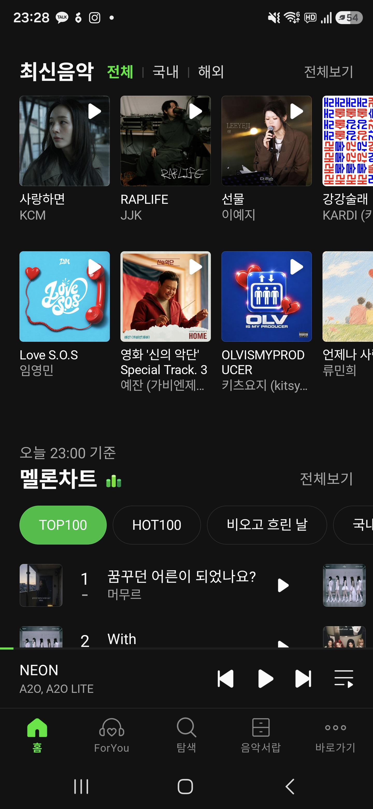
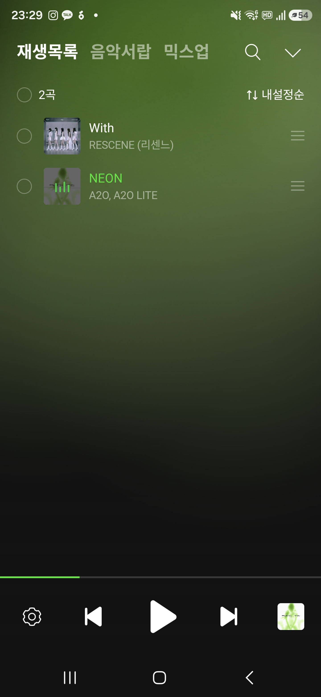
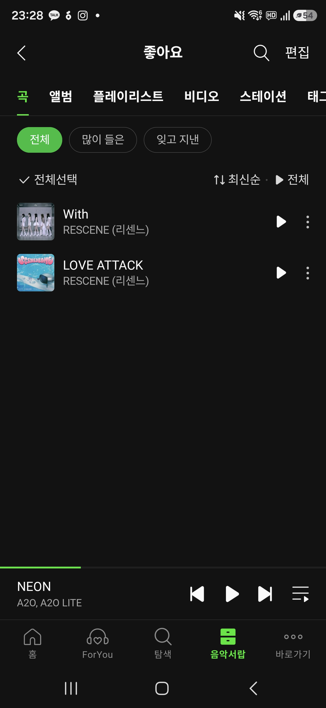
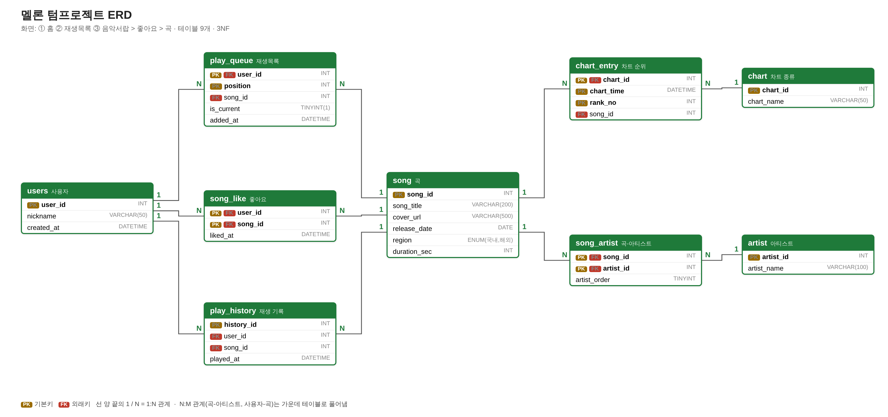

# 데이터베이스 텀프로젝트: 멜론 앱 DB 설계 & API

멜론 음악 앱의 화면 3개를 골라, 그 화면을 그리는 데 필요한 **데이터베이스를 설계**하고 **API를 개발**하는 4인 팀 프로젝트예요.

> **팀원 읽는 순서**
> 0. 문서 여는 법: VSCode로 이 폴더를 열고 .md 파일에서 `Ctrl + Shift + V`(미리보기). 메모장으로 열면 표가 깨져 보여요.
> 1. 이 README (5분)
> 2. [`docs/00_진행계획.md`](docs/00_진행계획.md): 진행 순서, 역할, 할 일, 카톡+ZIP 파일 공유 규칙(6절) (10분)
> 3. [`docs/03_결정사항.md`](docs/03_결정사항.md): **열린 결정사항에 의견 남기기**
> 4. [`docs/05_실행가이드.md`](docs/05_실행가이드.md): 내 PC에서 SQL과 API 실행해 보기
>
> 지금 버전: **v3.0**. 무엇이 바뀌었는지는 [`변경내역.md`](변경내역.md)에 있어요.

## AI(Claude, ChatGPT, Gemini 등)와 같이 작업할 때

[`AI용_전체자료.md`](AI용_전체자료.md) **파일 하나만 AI에 첨부**하면 돼요. 문서, SQL, API 코드가 전부 들어 있고, AI가 지켜야 할 규칙(정해진 것, 바꾸면 안 되는 것)도 맨 위에 적혀 있어요.
- 맨 위 "팀원용: AI에게 이렇게 물어보세요"의 문장을 복사해서 쓰면 돼요.
- 화면을 보여주고 싶으면 `images/`의 스크린샷도 같이 첨부해요. 과제 원문은 `참고자료/TP_DB_과제공지.pdf`에 있어요.
- AI가 고쳐 준 파일은 "어떤 파일의 어디를 왜 고쳤는지" 한 줄과 함께 관리자에게 보내 주세요.

## 과제 요구사항 (TP_DB.pdf 요약)

- 모바일 앱 1개 + 화면 3개 이상 선택
- 화면을 만들기 위한 **DB 구축** + 각 화면의 **API 개발**
- **발표 (10분 + Q&A 5분)**: 앱/화면 소개 → DB 설계 → API
- **보고서**: 앱/화면 소개, DB 설계(테이블, 쿼리, 데이터셋, ERD), API(입력값, JSON 출력)
- 사용 도구 (Week9_2): **Python, VSCode, Postman, MySQL**

## 진행 순서

진행 순서만 정해 두고, 단계별 날짜는 킥오프에서 팀이 정해요. 자세한 내용은 [`docs/00_진행계획.md`](docs/00_진행계획.md)에 있어요.

| 순서 | 단계 | 내용 |
|---|---|---|
| 0 | 기초 작업 ✅ | 계획, 화면 분석, 기초 테이블, 샘플 데이터, 쿼리 |
| 1 | 킥오프 | 역할 배정, 결정사항 확정, **단계별 날짜 정하기**, 각자 SQL 실행 확인 |
| 2 | DB 확정 + API 개발 🔶 | 스키마 확정, ERD, Flask API (**API 11개 구현 완료**) |
| 3 | 테스트 + 명세 | Postman 테스트, API 명세 완성 |
| 4 | 보고서 + 슬라이드 🔶 | 원고 취합, 최종 점검, 리허설 (**초안 완성**) |
| 5 | 제출 + 발표 | 슬라이드, 보고서 제출 → 10분 발표 + Q&A 5분 → 동료 평가 |

> 과제 공식 마감(교수님 공지): 슬라이드와 보고서 제출 **11/29(일) 23:59**, 발표 12/1(화) 또는 12/7(월)

## 선택한 화면

| # | 화면 | 범위 |
|---|---|---|
| 1 | 홈 | 최신음악(전체/국내/해외), 멜론차트(순위 변동 포함), 미니플레이어 |
| 2 | 재생목록 | 곡 수, 곡 리스트(내설정순), 현재 재생 곡 |
| 3 | 음악서랍 > 좋아요 > 곡 | 전체(최신순) / 많이 들은 / 잊고 지낸 |

  
  
  

## 기초 테이블 (9개) + VIEW 1개

- 테이블: `users`, `artist`, `song`, `song_artist`, `chart`, `chart_entry`, `play_queue`, `song_like`, `play_history`
- VIEW: `song_info` (곡 정보 + 아티스트 이름을 한 줄로 합친 것)
- 설명은 [`docs/02_DB설계.md`](docs/02_DB설계.md)

## 문서와 파일

| 파일 | 내용 | 상태 |
|---|---|---|
| [`docs/00_진행계획.md`](docs/00_진행계획.md) | 진행 순서, 역할(A~D), 단계별 할 일, 발표와 보고서 구성안, 파일 공유 규칙 | ✅ |
| [`docs/01_화면분석.md`](docs/01_화면분석.md) | 화면별 필요 데이터 | ✅ |
| [`docs/02_DB설계.md`](docs/02_DB설계.md) | ERD, 테이블, 정규화 근거, Q&A 대비 | ✅ 초안 |
| [`docs/03_결정사항.md`](docs/03_결정사항.md) | 결정할 것과 결정된 것 | 🔶 일부 의견 필요 |
| [`docs/04_API명세.md`](docs/04_API명세.md) | API 목록 11개, 시연 흐름 (JSON 예시는 보고서 4.2절) | ✅ |
| [`docs/05_실행가이드.md`](docs/05_실행가이드.md) | SQL·API 실행 방법과 기대 결과, md 여는 법 | ✅ |
| [`images/erd.png`](images/erd.png) | ERD 이미지 | ✅ 초안 |
| [`변경내역.md`](변경내역.md) | ZIP 버전별 변경 기록 | ✅ |
| [`AI용_전체자료.md`](AI용_전체자료.md) | AI에 첨부할 통합 파일 (문서 + SQL + API 코드, ZIP 만들 때 자동 생성) | ✅ |
| `images/` | 앱 스크린샷 3장 (`view1_home.jpg`, `view2_play_queue.jpg`, `view3_like_songs.jpg`) | ✅ |
| [`참고자료/TP_DB_과제공지.pdf`](참고자료/TP_DB_과제공지.pdf) | 교수님 과제 공지 원문 | ✅ |
| [`sql/01_schema.sql`](sql/01_schema.sql) | CREATE TABLE 9개 + CREATE VIEW 1개 | ✅ 실행 확인 |
| [`sql/02_sample_data.sql`](sql/02_sample_data.sql) | 샘플 데이터 (사용자 3, 곡 15, 차트 10위까지) | ✅ 실행 확인 |
| [`sql/03_view_queries.sql`](sql/03_view_queries.sql) | 화면별 SELECT 8개 | ✅ 실행 확인 |
| [`api/`](api/README.md) | Flask API 11개 (`app.py`, `db.py`, `config.example.py`, `requirements.txt`, `postman_collection.json`, 실행 방법 `README.md`) | ✅ 실행 확인 |
| `report/보고서.docx` | 보고서 초안 (이름·역할 칸 비어 있음) | 🔶 초안 |
| `report/발표슬라이드.pptx` | 발표 슬라이드 초안 16장 (발표자 칸 비어 있음, 14번 Postman 캡처 교체 필요) | 🔶 초안 |
