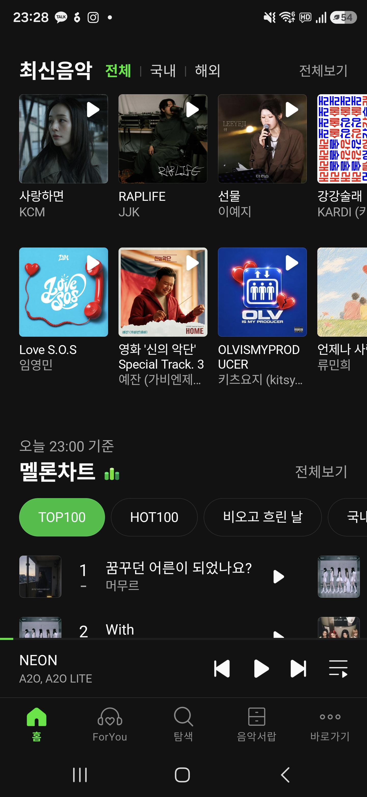

# 01. 화면 분석: 화면을 그리려면 어떤 데이터가 필요한가?

교수님 예시(카카오톡 친구 화면)와 같은 방식으로, 각 화면에 보이는 요소를 하나씩 뜯어서 **필요한 데이터**를 뽑았습니다.
여기서 뽑은 데이터가 [`02_DB설계.md`](02_DB설계.md)의 테이블이 됩니다.

---

## ① 홈

| 영역 | 화면에 보이는 것 | 필요한 데이터 |
|---|---|---|
| 최신음악 | 앨범 커버, 곡명, 아티스트명 | 곡명, 아티스트명, 앨범 커버 URL |
| 최신음악 | 최신순으로 나열 | **발매일** |
| 최신음악 | 전체 / 국내 / 해외 탭 | **국내/해외 구분** |
| 멜론차트 | "오늘 23:00 기준" | **차트 기준 시각** (차트가 시간마다 갱신됨) |
| 멜론차트 | TOP100 / HOT100 / 비오고 흐린 날 / 국내… | **차트 종류** |
| 멜론차트 | 1, 2, … | **순위** |
| 멜론차트 | 순위 아래 "-" | **순위 변동** (이전 시각 순위와 비교) |
| 멜론차트 | 커버, 곡명, 아티스트명 | 곡 정보 |
| 미니플레이어 | NEON / A20, A20 LITE | **지금 재생 중인 곡** (재생목록 화면과 같은 데이터) |

---

## ② 재생목록

| 영역 | 화면에 보이는 것 | 필요한 데이터 |
|---|---|---|
| 상단 | "2곡" | 재생목록의 곡 수 (COUNT로 계산) |
| 상단 | "내설정순" | **사용자가 정한 순서** (곡마다 순서 번호) |
| 리스트 | 커버, 곡명 | 곡 정보 |
| 리스트 | "A20, A20 LITE" | **한 곡에 아티스트가 여러 명**일 수 있음 |
| 리스트 | NEON만 초록색 | **현재 재생 중인 곡이 무엇인지** |
| 하단 | 진행바 | 재생 위치 (선택: 범위에 넣을지 결정 필요) |
| 상단 탭 | 재생목록 / 음악서랍 / 믹스업 | 이번 과제에서는 "재생목록" 탭만 다룸 |

> ⚠️ 이 화면은 멜론의 "재생목록"(지금 듣는 곡 대기열)입니다. 사용자가 이름을 붙여 만드는 "플레이리스트"와는 다릅니다.
> 어느 쪽으로 할지는 [`03_결정사항.md`](03_결정사항.md) 참고.

---

## ③ 음악서랍 > 좋아요 > 곡

| 영역 | 화면에 보이는 것 | 필요한 데이터 |
|---|---|---|
| 탭 | 곡 / 앨범 / 플레이리스트 / 비디오 / 스테이션 / 태그 | 이번 과제에서는 **곡** 탭만 (결정 필요) |
| 리스트 | 커버, 곡명, 아티스트명 | 좋아요한 곡 정보 |
| 정렬 | "최신순" | **좋아요 누른 시각** |
| 필터 | 전체 | 좋아요한 곡 전부 |
| 필터 | 많이 들은 | **곡별 재생 횟수** |
| 필터 | 잊고 지낸 | **곡별 마지막 재생 시각** |
| 버튼 | ▶ 전체 | 좋아요 곡 전체를 재생목록에 넣기 (재생목록 테이블에 INSERT) |

---

## 정리: 뽑아낸 데이터 → 테이블 후보

| 데이터 | 테이블 후보 |
|---|---|
| 사용자 | User |
| 곡명, 재생시간 | Song |
| 아티스트명 | Artist |
| 한 곡에 여러 아티스트 | Song_Artist |
| 앨범 커버, 발매일, 국내/해외 | Album |
| 차트 종류 | Chart |
| 차트 기준 시각, 순위 | Chart_Entry |
| 재생목록 순서, 현재 재생 곡 | Play_Queue |
| 좋아요, 좋아요 시각 | Song_Like |
| 재생 횟수, 마지막 재생 시각 | Play_History |
