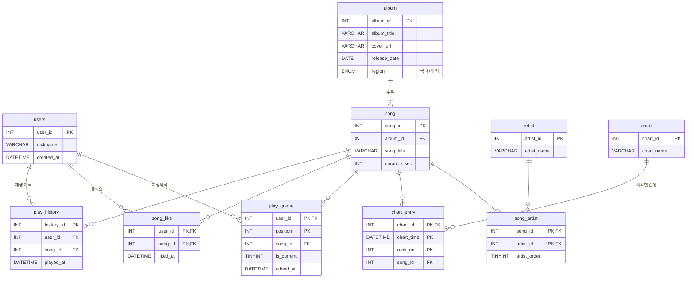

# 02. DB 설계

[`01_화면분석.md`](01_화면분석.md)에서 뽑은 데이터로 만든 기초 테이블이에요. 모든 테이블은 **3NF 이상**을 목표로 해요 (Week9_1 수업 내용).

> 상태: **기초 테이블 완료** (`sql/01_schema.sql`, MySQL 8 엄격 모드에서 실행 확인). Phase 1 킥오프 피드백을 받은 뒤 확정해요.
> 실제 SQL: [`../sql/01_schema.sql`](../sql/01_schema.sql), 샘플 데이터: [`../sql/02_sample_data.sql`](../sql/02_sample_data.sql), 화면별 쿼리: [`../sql/03_view_queries.sql`](../sql/03_view_queries.sql)

## ERD (초안)

GitHub에서 보면 다이어그램으로 그려져요. 발표용 ERD는 Phase 2에서 MySQL Workbench로 다시 그려요.

## 테이블 상세

| # | 테이블 | PK | FK | 주요 컬럼 | 쓰이는 화면 |
|---|---|---|---|---|---|
| 1 | `users` | user_id | | nickname, created_at | 전체 |
| 2 | `artist` | artist_id | | artist_name ("RESCENE (리센느)" 그대로) | 전체 |
| 3 | `album` | album_id | | album_title, cover_url, release_date, region(국내/해외) | 홈 (최신음악) |
| 4 | `song` | song_id | album_id → album | song_title, duration_sec | 전체 |
| 5 | `song_artist` | (song_id, artist_id) | song, artist | artist_order (표시 순서) | 전체 |
| 6 | `chart` | chart_id | | chart_name (TOP100, HOT100, 비오고 흐린 날) | 홈 (멜론차트) |
| 7 | `chart_entry` | (chart_id, chart_time, rank_no) | chart, song | UNIQUE(chart_id, chart_time, song_id) | 홈 (멜론차트) |
| 8 | `play_queue` | (user_id, position) | users, song | is_current, added_at | 재생목록, 미니플레이어 |
| 9 | `song_like` | (user_id, song_id) | users, song | liked_at | 좋아요 |
| 10 | `play_history` | history_id | users, song | played_at | 좋아요 (많이 들은 / 잊고 지낸) |

### 설계하면서 정한 것 (발표 Q&A 대비)
| 질문 | 답 |
|---|---|
| 왜 `user`가 아니라 `users`? | `user`는 MySQL 시스템 테이블(mysql.user)과 헷갈리고, 일부 도구에서 예약어로 취급해서 |
| 왜 `rank`가 아니라 `rank_no`? | `RANK`는 MySQL 8의 예약어(윈도우 함수)라서 |
| 재생목록 PK가 왜 (user_id, song_id)가 아니라 (user_id, position)? | 같은 곡을 재생목록에 두 번 넣을 수 있어서. 순서(내설정순)도 position으로 표현 |
| 좋아요 PK는 왜 (user_id, song_id)? | 같은 곡에 좋아요를 두 번 누를 수 없어서. 중복이 DB 단계에서 막혀요 |
| 재생 기록은 왜 따로 history_id? | 같은 곡을 여러 번 들으니 (user_id, song_id)가 중복돼요. 그래서 행마다 고유 번호를 줘요 |
| 차트에 왜 시각(chart_time)이 PK에 있나? | 차트가 매시 갱신되고, 순위 변동을 계산하려면 이전 시각 기록이 필요해서 |
| 국내/해외는 왜 album에? | 최신음악은 앨범(발매) 단위로 나와서. 아티스트 단위로 볼지는 결정사항 #8 |

## 관계 요약

| 관계 | 종류 | 설명 |
|---|---|---|
| album – song | 1 : N | 앨범 하나에 곡 여러 개, 곡은 앨범 하나에 속함 |
| song – artist | N : M | `song_artist`로 풀어냄 ("A20, A20 LITE") |
| chart – chart_entry | 1 : N | 차트 하나에 시각별, 순위별 기록 여러 개 |
| song – chart_entry | 1 : N | 한 곡이 여러 시각, 여러 차트에 등장 |
| users – song (좋아요) | N : M | `song_like` |
| users – song (재생목록) | N : M | `play_queue` (같은 곡 중복 가능) |
| users – song (재생 기록) | N : M | `play_history` (같은 곡 여러 번) |

## 정규화 근거 (발표, 보고서용)

수업 자료의 1NF → 2NF → 3NF 흐름처럼, "화면에 보이는 걸 한 테이블에 다 넣었다면?"에서 출발해요.

### 출발점: 재생목록 화면을 그대로 표로 만들면 (비정규형)
| user_id | position | song_title | artists | album_title | cover_url | liked_at |
|---|---|---|---|---|---|---|
| 1 | 1 | With | RESCENE (리센느) | … | …/9.jpg | 2026-11-14 |
| 1 | 2 | NEON | **A20, A20 LITE** | NEON | …/11.jpg | |

### 1NF: 반복 그룹 제거
`A20, A20 LITE`처럼 한 칸에 값이 여러 개 → **반복 그룹**
→ `song_artist(song_id, artist_id)`로 한 행에 아티스트 하나씩

### 2NF: 부분 종속 제거
`song_like(`**user_id, song_id**`, liked_at, song_title)`이라면
- (user_id, song_id) → liked_at ✅
- song_id → song_title ❌ **부분 종속** (PK 일부에만 종속)
→ song_title은 `song`에만 두고 JOIN으로 가져와요.

### 3NF: 이행 종속 제거
`song(`**song_id**`, album_id, cover_url, release_date)`이라면
- song_id → album_id → cover_url, release_date ❌ **이행 종속**
→ cover_url, release_date, region은 `album`으로 분리

### 일부러 저장하지 않는 값 (계산으로 구함)
| 화면 값 | 구하는 방법 (`03_view_queries.sql`) |
|---|---|
| 재생목록 "2곡" | `COUNT(*)` from play_queue |
| 아티스트 "A20, A20 LITE" | `GROUP_CONCAT(artist_name ORDER BY artist_order)` |
| 차트 순위 변동 | 같은 차트의 **직전 chart_time**과 LEFT JOIN → `이전 순위 - 현재 순위` (없으면 NEW) |
| 많이 들은 | play_history `COUNT(*)` 내림차순 |
| 잊고 지낸 | play_history `MAX(played_at)`이 30일 이전이거나 재생 기록이 없는 좋아요 곡 |

순위 변동이나 재생 횟수를 컬럼으로 저장하면, 원본이 바뀔 때마다 같이 고쳐야 해요(**갱신 이상**). 그래서 계산 방식을 택했어요.
