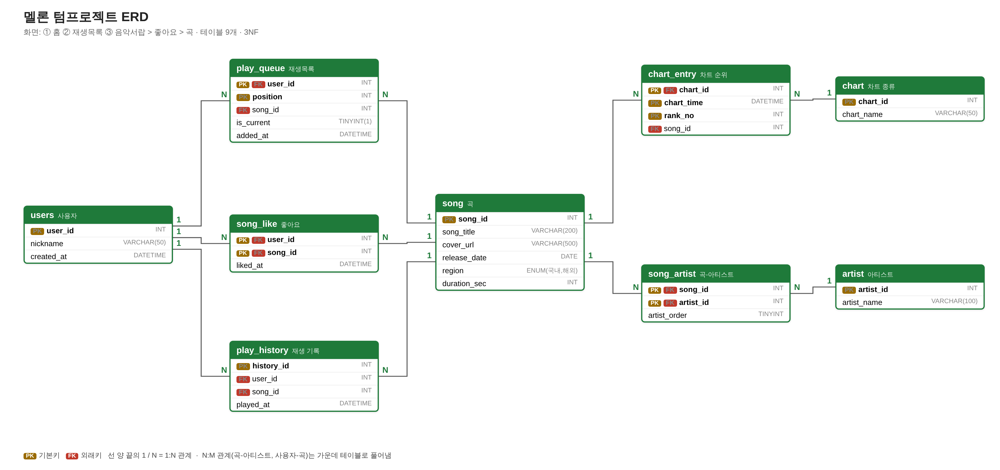

# 02. DB 설계

[`01_화면분석.md`](01_화면분석.md)에서 뽑은 데이터로 만든 기초 테이블이에요. 모든 테이블은 **3NF 이상**을 목표로 해요 (Week9_1 수업 내용).

> 상태: **기초 테이블 완료** (`sql/01_schema.sql`). MySQL 호환 서버에서 MySQL 8 기본 설정(엄격한 GROUP BY 모드)으로 실행해 확인했어요. Phase 1 킥오프 피드백을 받은 뒤 확정해요.
> 실제 SQL: [`../sql/01_schema.sql`](../sql/01_schema.sql), 샘플 데이터: [`../sql/02_sample_data.sql`](../sql/02_sample_data.sql), 화면별 쿼리: [`../sql/03_view_queries.sql`](../sql/03_view_queries.sql)

## ERD (초안)

> 이미지 파일: [`../images/erd.png`](../images/erd.png). 발표용 ERD는 Phase 2에서 MySQL Workbench로 다시 그려요(결정사항 #6).

## 테이블 상세

| # | 테이블 | PK | FK | 주요 컬럼 | 쓰이는 화면 |
|---|---|---|---|---|---|
| 1 | `users` | user_id | | nickname, created_at | 전체 |
| 2 | `artist` | artist_id | | artist_name ("RESCENE (리센느)" 그대로) | 전체 |
| 3 | `song` | song_id | | song_title, cover_url, release_date, region(국내/해외), duration_sec | 전체 |
| 4 | `song_artist` | (song_id, artist_id) | song, artist | artist_order (표시 순서) | 전체 |
| 5 | `chart` | chart_id | | chart_name (TOP100, HOT100, 비오고 흐린 날) | 홈 (멜론차트) |
| 6 | `chart_entry` | (chart_id, chart_time, rank_no) | chart, song | UNIQUE(chart_id, chart_time, song_id) | 홈 (멜론차트) |
| 7 | `play_queue` | (user_id, position) | users, song | is_current, added_at | 재생목록, 미니플레이어 |
| 8 | `song_like` | (user_id, song_id) | users, song | liked_at | 좋아요 |
| 9 | `play_history` | history_id | users, song | played_at | 좋아요 (많이 들은 / 잊고 지낸) |

### VIEW: `song_info`
화면별 쿼리 8개 중 7개가 "곡명 + 아티스트(여러 명이면 쉼표로) + 커버"를 보여줘요(나머지 1개는 곡 수 COUNT). 이 조합을 VIEW 하나로 만들어 두고, 화면별 쿼리는 이 VIEW를 JOIN해서 써요.
- **저장은 정규화해서**: 아티스트는 `song_artist`에 한 줄에 한 명씩 저장(1NF)
- **보여줄 때는 VIEW로 합쳐서**: `A20, A20 LITE`처럼 곡당 한 줄
- VIEW는 데이터를 따로 저장하지 않는 "저장된 SELECT"라서 정규화가 깨지지 않아요

### 설계하면서 정한 것 (발표 Q&A 대비)
| 질문 | 답 |
|---|---|
| 왜 `user`가 아니라 `users`? | `user`는 MySQL 시스템 테이블(mysql.user)과 헷갈리고, 일부 도구에서 예약어로 취급해서 |
| 왜 `rank`가 아니라 `rank_no`? | `RANK`는 MySQL 8의 예약어(윈도우 함수)라서 |
| 재생목록 PK가 왜 (user_id, song_id)가 아니라 (user_id, position)? | 같은 곡을 재생목록에 두 번 넣을 수 있어서. 순서(내설정순)도 position으로 표현 |
| 좋아요 PK는 왜 (user_id, song_id)? | 같은 곡에 좋아요를 두 번 누를 수 없어서. 중복이 DB 단계에서 막혀요 |
| 재생 기록은 왜 따로 history_id? | 같은 곡을 여러 번 들으니 (user_id, song_id)가 중복돼요. 그래서 행마다 고유 번호를 줘요 |
| 차트에 왜 시각(chart_time)이 PK에 있나? | 차트가 매시 갱신되고, 순위 변동을 계산하려면 이전 시각 기록이 필요해서 |
| 앨범 테이블은 왜 없나? | 고른 화면 3개는 모두 **곡 단위**로 보여줘요(앨범 화면이 없음). 커버, 발매일, 국내/해외를 `song`에 두면 모두 song_id에만 종속돼서 3NF를 만족해요 |
| 재생 기록은 어떻게 쌓이나? | `POST /api/users/<id>/plays` API가 `play_history`에 INSERT 한 줄을 해요. history_id(AUTO_INCREMENT)와 played_at(DEFAULT CURRENT_TIMESTAMP)이 처음부터 있어서 **테이블을 고치지 않고** API만 추가했어요 |
| 그럼 한계는? | 같은 앨범의 곡이 여러 개면 커버와 발매일이 곡마다 반복 저장돼요. 앨범 화면을 추가한다면 `album` 테이블을 분리하는 게 개선 방향이에요 |

## 정규화 근거 (발표, 보고서용)

수업 자료(Week9_1)의 1NF → 2NF → 3NF 흐름 그대로, **재생목록 화면을 한 테이블에 다 넣은 것**에서 출발해 나눠요.

### 출발점: 재생목록 화면을 그대로 표로 만들면
PK = (user_id, position)

| <u>user_id</u> | <u>position</u> | nickname | song_id | song_title | cover_url | artists |
|---|---|---|---|---|---|---|
| 1 | 1 | 멜론유저 | 1 | With | …/1.jpg | RESCENE (리센느) |
| 1 | 2 | 멜론유저 | 3 | NEON | …/3.jpg | **A20, A20 LITE** |

### 1NF: 반복 그룹 제거
- `A20, A20 LITE`처럼 한 칸에 값이 여러 개 → **반복 그룹**
- → 아티스트를 `artist(artist_id, artist_name)`로 빼고, 곡과의 연결은 `song_artist(song_id, artist_id)`로 한 행에 하나씩 저장

### 2NF: 부분 종속 제거
- (user_id, position) → song_id ✅
- **user_id → nickname** ❌ **부분 종속** (PK의 일부인 user_id에만 종속)
- → nickname은 `users(user_id, nickname)`로 분리

### 3NF: 이행 종속 제거
- **(user_id, position) → song_id → song_title, cover_url** ❌ **이행 종속** (키가 아닌 song_id를 거쳐서 결정됨)
- → 곡 정보는 `song(song_id, song_title, cover_url, …)`로 분리

### 결과
| 테이블 | 남는 컬럼 |
|---|---|
| `play_queue` | <u>user_id</u>, <u>position</u>, song_id, is_current, added_at |
| `users` | <u>user_id</u>, nickname |
| `song` | <u>song_id</u>, song_title, cover_url, release_date, region, duration_sec |
| `song_artist` | <u>song_id</u>, <u>artist_id</u>, artist_order |
| `artist` | <u>artist_id</u>, artist_name |

나머지 테이블(`song_like`, `play_history`, `chart`, `chart_entry`)도 같은 방식으로 곡과 사용자 정보는 ID로만 참조해요. 그래서 모두 3NF예요.

### 일부러 저장하지 않는 값 (계산으로 구함)
| 화면 값 | 구하는 방법 (`03_view_queries.sql`) |
|---|---|
| 재생목록 "2곡" | `COUNT(*)` from play_queue |
| 아티스트 "A20, A20 LITE" | **VIEW `song_info`** 안에서 `GROUP_CONCAT(artist_name ORDER BY artist_order)`로 합침. 화면별 쿼리는 모두 이 VIEW를 JOIN |
| 차트 순위 변동 | 같은 차트의 **직전 chart_time**과 LEFT JOIN → `이전 순위 - 현재 순위` (없으면 NEW) |
| 많이 들은 | play_history `COUNT(*)`가 **3회 이상**인 좋아요 곡, 많이 들은 순 (`HAVING`) |
| 잊고 지낸 | play_history `MAX(played_at)`이 30일 이전이거나 재생 기록이 없는 좋아요 곡 |

순위 변동이나 재생 횟수를 컬럼으로 저장하면, 원본이 바뀔 때마다 같이 고쳐야 해요(**갱신 이상**). 그래서 계산 방식을 택했어요.
